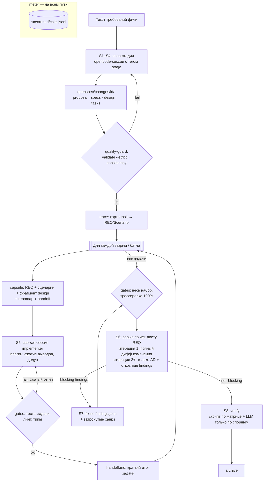
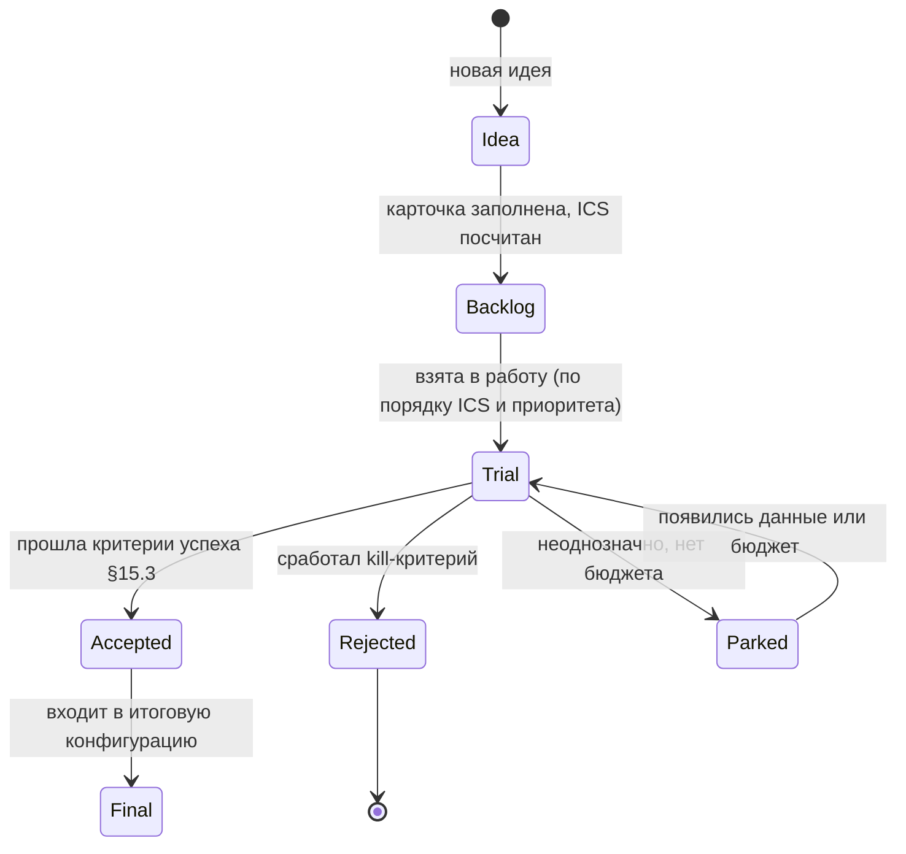
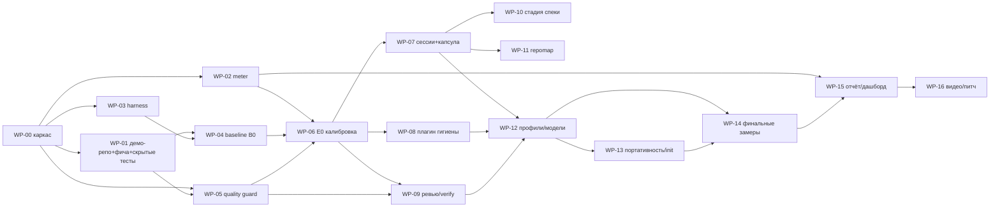

# ТЗ: Frugal SDD — экономия токенов в SDD-конвейере без потери качества

> **Кейс:** СберТех «Экономия токенов в SDD-разработке» · Хакатон Студсовета ФПМИ 2026 (hackathon.fpmi.tech)
> **Принцип планирования.** Все пакеты и гипотезы входят в программу разработки. Порядок перехода определяют зависимости и гейты (§16). Очередь прогонов на доступные 27 часов, приоритеты при дефиците пропускной способности и резерв на сдачу задаёт [единая стратегия](STRATEGY.md). Бюджет и минимальные размеры серий определяет §10.
> **Рабочее название решения:** `frugal` (Frugal SDD). Название можно менять, в коде и документах оно встречается только в виде `frugal`.
> **Статус документа:** v1.2, автономная разработка через Codex. Изменения вносятся по процедуре из §15 и фиксируются в журнале изменений (§20). Единый вход для запуска и возобновления — [стартовый промпт](docs/START_PROMPT.md).
> **Первоисточник истины:** PDF кейса (`case/token-efficient-sdd.pdf`, пересказ в §2.1). При любом противоречии побеждает кейс, затем это ТЗ, затем всё остальное.
> **Связанные документы:**
> - [`RESEARCH.md`](RESEARCH.md): сводка документации и готовых решений. На её разделы ссылаются пометки `[R:§хакатон]`, `[R:§openspec]`, `[R:§opencode]`, `[R:§куда уходят токены]`, `[R:§техники]`, `[R:§инструменты]`, `[R:§методика]`, `[R:§учёт токенов]`, `[R:§модели]`;
> - [`docs/research/`](docs/research/): сырые заметки исследования по темам;
> - [`AGENTS.md`](AGENTS.md): правила для кодинг-агентов, которые будут разрабатывать решение;
> - [`docs/HYPOTHESES.md`](docs/HYPOTHESES.md): живой реестр гипотез (статусы, результаты);
> - [`docs/DECISIONS.md`](docs/DECISIONS.md): журнал решений;
> - [`docs/EXPERIMENTS.md`](docs/EXPERIMENTS.md): журнал прогонов.

---

## Оглавление

0. [Как пользоваться этим ТЗ](#0-как-пользоваться-этим-тз)
1. [Резюме](#1-резюме-tldr)
2. [Исходные данные и стратегия по критериям](#2-исходные-данные-и-стратегия-по-критериям)
3. [Анализ проблемы: куда уходят токены](#3-анализ-проблемы-куда-уходят-токены)
4. [Цели, метрики и пороги](#4-цели-метрики-и-пороги)
5. [Скоуп](#5-скоуп)
6. [Архитектура решения](#6-архитектура-решения)
7. [Контрольный процесс (baseline B0)](#7-контрольный-процесс-baseline-b0)
8. [Каталог оптимизаций и гипотезы](#8-каталог-оптимизаций-и-гипотезы)
9. [Контур качества (Quality Guard)](#9-контур-качества-quality-guard)
10. [Протокол экспериментов](#10-протокол-экспериментов)
11. [Универсальность: модели разного размера](#11-универсальность-модели-разного-размера)
12. [Портативность](#12-портативность)
13. [Демо-стенд и демо-фича](#13-демо-стенд-и-демо-фича)
14. [Отчёт, демо и защита](#14-отчёт-демо-и-защита)
15. [Управление дрейфом и гипотезами](#15-управление-дрейфом-и-гипотезами)
16. [План работ и пакеты для промптов](#16-план-работ-и-пакеты-для-промптов)
17. [Риски](#17-риски)
18. [Открытые вопросы](#18-открытые-вопросы)
19. [Приложения](#19-приложения)
20. [Журнал изменений ТЗ](#20-журнал-изменений-тз)

---

## 0. Как пользоваться этим ТЗ

ТЗ написано так, чтобы его можно было **резать на промпты** для кодинг-агентов. Разработка ведётся через **Codex**: он читает `AGENTS.md` нативно, а пакеты можно запускать параллельно в отдельных git worktree (§16.4). Каждый рабочий пакет из §16 (`WP-xx`) самодостаточен: у него есть входы, выходы, критерии приёмки (DoD) и ссылки на нужные разделы ТЗ. Готовые промпты первой волны (WP-00, 01, 02, 03, 05) лежат в §19.6. Остальные собираются по шаблону:

```
Роль: <из WP>. Прочитай AGENTS.md, затем разделы ТЗ: <список §>.
Задача: <WP-xx: цель>.
Входы: <...>. Выходы: <...>.
Критерии приёмки: <DoD из WP>.
Ограничения: <из §2.2 и AGENTS.md>.
По завершении: обнови docs/HYPOTHESES.md / docs/EXPERIMENTS.md / docs/DECISIONS.md, если затронуто.
```

Обязательность формулировок:

| Слово | Смысл |
|---|---|
| **ДОЛЖНО / ОБЯЗАТЕЛЬНО** | Нарушение означает дисквалификацию решения или провал критерия кейса. Обсуждать нельзя. |
| **СЛЕДУЕТ** | Делаем по умолчанию. Отступить можно, но с записью в `DECISIONS.md` и обоснованием. |
| **МОЖНО** | На усмотрение исполнителя. |
| **ГИПОТЕЗА H-xx** | Не решение, а ставка. Принимается или отклоняется только по результатам замера (§15). |

---

## 1. Резюме (TL;DR)

**Что строим.** `frugal`: набор из CLI, плагина opencode и конфигурации OpenSpec. Он встраивается в стандартный SDD-конвейер (OpenSpec + opencode) и снижает расход токенов на фичу. Требования, стадии, модель и провайдер остаются прежними.

**Главная ставка (почему это сработает).** В агентном цикле каждый вызов LLM заново получает всю историю сессии. Поэтому суммарный входной объём растёт **квадратично** от числа вызовов в сессии (§3.2). Основной расход создаёт не размер спеки, а то, что одна и та же история и одни и те же логи прогоняются через модель десятки раз. Отсюда три рычага (в порядке ожидаемого эффекта):

1. **Архитектура сессий.** Короткая свежая сессия на задачу с компактной «капсулой» (только релевантные требования, фрагмент design, карта файлов) вместо одной длинной сессии `apply`. Квадратичный член уменьшается в разы.
2. **Ревью и верификация.** Сначала детерминированные гейты (тесты, линтер, трассировка требований), затем LLM-ревью по чек-листу из спеки, на последующих итерациях только по изменённому диффу. Цель: 1–2 итерации ревью вместо 3–5, и каждая итерация дешевле.
3. **Гигиена контекста.** Сжатие выводов инструментов (логи тестов → только падения, диффы → минимальный контекст), дедупликация повторных чтений, урезанный системный оверхед, маскирование старых наблюдений.

Плюс **кэш-дружелюбная раскладка промптов**. Сырые токены она не уменьшает, а стоимость снижает. Отчитываемся о ней **отдельно и честно** (§4.1).

**Чем выигрываем у других команд** (§2.4): измерение с доверительными интервалами и абляцией вместо одного прогона «до/после»; модель расхода токенов как обоснование; доказательство качества скрытыми приёмочными тестами и матрицей трассировки; прогон на моделях разного размера (включая эффект «маленькая модель с нашим конвейером справляется, без него нет»); `frugal init` на чужом репозитории без правок кода.

**Целевые числа** (уточняются после калибровки E0, §10):

| Метрика | Минимум | Цель | Амбиция |
|---|---|---|---|
| Экономия сырых токенов на фичу (медиана, большая модель) | ≥ 40 % | ≥ 60 % | ≥ 75 % |
| Экономия сырых токенов (малая модель) | ≥ 30 % | ≥ 50 % | ≥ 65 % |
| Покрытие требований/сценариев тестами | 100 % | 100 % | 100 % |
| Зелёные тесты по каждой задаче | 100 % | 100 % | 100 % |
| Скрытые приёмочные тесты (opt vs base) | не хуже base | не хуже base | лучше base |
| Итерации ревью (медиана) | ≤ base | ≤ 2 | 1 |
| Портативность: правок кода `frugal` для второго репо | 0 | 0 | 0 |

---

## 2. Исходные данные и стратегия по критериям

### 2.1. Кейс (первоисточник, пересказ PDF)

**Контекст.** Команда разрабатывает продукт с кодинг-агентом в подходе SDD: требования → спека (proposal, specs, design, tasks) → реализация агентом → ревью → проверка по артефактам. Одна фича состоит из 8–12 задач и проходит 3–5 итераций ревью. На каждом этапе агент перечитывает спеку и контекст проекта, ревьюеры гоняют анализ по одному и тому же коду, тестовые логи и диффы повторно проходят через LLM. Счёт за фичу доходит до миллионов токенов. В длинных сессиях агент не удерживает весь контекст, и качество падает.

**Задача.** Снизить расход токенов в SDD-конвейере, не потеряв в качестве результата.

**Что сдаётся:**
1. Прототип: CLI, плагин или скрипты, встраиваемые в SDD-пайплайн. База: openspec-структура `openspec/changes/<id>/{proposal,specs,design,tasks}.md` и агент, исполняющий tasks.
2. A/B-демо на одной фиче: как процесс идёт без оптимизаций и с ними.
3. Отчёт: токены по стадиям (before/after), качество (покрытие требований, результат тестов, число итераций ревью), где главная экономия.
4. Запись демонстрации проекта.

**База:** opencode и openspec, их использование рекомендуется.

### 2.1а. Контекст хакатона и заказчика (по данным исследования, [R:§хакатон])

| Факт | Значение | Что из этого следует для нас |
|---|---|---|
| Формат | Очный хакатон ФПМИ с финальной презентацией решений | Решение защищается перед экспертами СберТеха: отчёт и видео строятся под критерии (§14) |
| Команда | 4–6 человек; разработка через Codex | Работаем параллельными потоками (§16.4), объём кода не ограничен |
| Правила | «Пользуйтесь чем угодно»; положения, формата сдачи и регламента защиты в открытом доступе нет | Уточнить формат сдачи и длительность защиты у организаторов (OQ-3) |
| Другие кейсы СберТеха | «IDE для spec-driven разработки с OpenSpec»; «LLM-помощник внутри psql» (в закрытом контуре) | Заказчику важны OpenSpec/SDD и **локальные модели**: малая модель с открытыми весами в матрице универсальности будет заметна |
| Позиция Сбера | На GigaConf (10.2026): «Мы идём в сторону SDD»; агентную разработку используют «100 % инженеров»; модели меняются раз в 1–2 месяца; в августе 2026 генеративная разработка Сбера потребила около 9 трлн токенов | Экономия токенов для заказчика напрямую про деньги. Важно, чтобы решение не было привязано к модели (критерий универсальности) |
| Харнесс важнее модели | Там же: 9 агентных харнессов на одной модели закрыли от 62 до 80 % задач | Наш тезис «конвейер, а не модель, определяет и цену, и качество» совпадает с тезисом заказчика |

### 2.2. Жёсткие ограничения (инварианты)

| ID | Инвариант | Как проверяется автоматически |
|---|---|---|
| **INV-1** | Покрытие требований спеки кодом и тестами: 100 %. Каждое требование (`### Requirement:`) и каждый сценарий (`#### Scenario:`) покрыт хотя бы одним **проходящим** тестом. | `frugal trace` → матрица трассировки, `coverage_req == 1.0` (§9.2) |
| **INV-2** | Тесты на каждую задачу, все зелёные. | `frugal gates` → для каждой задачи `tasks.md` есть ≥1 тест с её ID, весь набор тестов зелёный (§9.3) |
| **INV-3** | Артефакты изменения (specs, design, tasks) согласованы. | `openspec validate --strict` + `frugal consistency` (§9.4) |
| **INV-4** | Требования не урезаются. | Хэш-сравнение множества требований и сценариев на входе и выходе стадии spec (между B0 и opt допустимы различия только в формулировках, которые сгенерировала модель; исходный текст требований один и тот же) (§9.5) |
| **INV-5** | Этапы не пропускаются: proposal, specs, design, tasks, implement, review (≥1 итерация LLM-ревью), verify. | Манифест прогона содержит события всех стадий (§10.6) |
| **INV-6** | Модель и провайдер не меняются **внутри A/B-пары**. | Манифест: `model_id` одинаков во всех LLM-вызовах обеих веток (§10.6) |

> **Трактовка INV-6.** «Не менять модель» означает: в сравнении base vs opt используется одна и та же модель у одного и того же провайдера на всех стадиях. Нельзя, например, удешевить ревью, отдав его маленькой модели. Прогон A/B **на нескольких моделях по очереди** (каждая пара на своей модели) инвариант не нарушает. Это и есть требование критерия «универсальность».

> **Трактовка INV-5.** Объединять стадии **в одном вызове** (например, design и tasks одной генерацией) СЛЕДУЕТ только если все артефакты создаются полностью и каждый проходит свой гейт. Иначе это выглядит как «пропуск этапа». По умолчанию сохраняем отдельные стадии, а экономим внутри них.

### 2.3. Критерии оценки → стратегия максимизации балла

| Критерий | Вес | Что видит жюри | Наша стратегия | Доказательство (артефакт) |
|---|---|---|---|---|
| % экономии, подтверждённый замером | **35 %** | Цифру экономии и то, насколько ей можно верить | Независимый счётчик токенов (из БД opencode + сверка с ответами провайдера), парные A/B-прогоны с чередованием, все точки на графике, парные отношения и знаковый критерий, разбивка по стадиям, сырые токены отдельно от кэша | `report/REPORT.md`, `report/dashboard.html`, сырые `runs/*.jsonl`, скрипт воспроизведения одной командой |
| Качество не просело | **25 %** | Тесты, покрытие спеки | INV-1..3 как автоматические гейты, скрытые приёмочные тесты, итерации ревью, (опц.) мутационный скор | Таблица качества base vs opt на каждой модели, матрица трассировки |
| Универсальность (мелкие и крупные LLM) | **15 %** | Работает ли на разных моделях | Профили `small`/`large`, A/B на ≥ 4 моделях разного размера минимум двух провайдеров, эффект для мелких моделей | Матрица «модель × экономия × качество» |
| Портативность (другой репо без переписывания) | **10 %** | Можно ли взять и поставить | `frugal init` с автодетектом, A/B на двух сторонних репо на других языках без правок кода, работа на обеих линиях opencode (V1 и V2) | Видео и лог `frugal init` на чужом репо, результаты A/B на нём |
| Обоснование (какие стадии съедают больше всего) | **15 %** | Понимание природы расхода | Аналитическая модель (§3.2) + калибровочный замер E0 + абляция (вклад каждой оптимизации) | Раздел «Где токены» в отчёте: stacked bar по стадиям, водопад экономии по оптимизациям |

Вывод для приоритизации: **60 % балла (35 + 25) дают замер и качество.** Поэтому инфраструктура замера и контур качества строятся **первыми** (WP-02..WP-05) и раньше любых оптимизаций. Оптимизация без честного замера стоит ноль баллов.

### 2.4. Конкурентная стратегия

Другие команды тоже используют сильные модели (Claude и др.), поэтому «очевидные» оптимизации (кэширование, компакция, короткие промпты) будут у многих. Отличаемся тем, что требует системного подхода и большого объёма инженерной работы, которую мы можем себе позволить:

1. **Строгость замера.** Повторные прогоны, доверительные интервалы, изоляция окружения, сырые и кэшированные токены раздельно. У большинства будет один прогон «до/после», и жюри это заметит.
2. **Абляция.** Показываем вклад каждой оптимизации (водопад) и разбивку по стадиям. Это прямо закрывает критерий «обоснование».
3. **Модель расхода** (квадратичный рост истории): теоретическое объяснение, которое затем подтверждается данными.
4. **Скрытые приёмочные тесты.** Качество проверяется не только тестами, которые написал сам агент (их можно «подогнать»), но и независимым набором.
5. **Эффект на малых моделях.** Если baseline на маленькой модели не доходит до конца (переполнение контекста, потеря нити), а с `frugal` доходит, это сильнейший аргумент за универсальность.
6. **Портативность вживую:** `frugal init` на стороннем open-source репозитории в видео.
7. **Честность.** Явно говорим, что кэш не уменьшает сырые токены, и показываем обе метрики. Жюри из инженерной компании это ценит, а завышенные цифры у конкурентов при вопросах рассыпаются.

---

## 3. Анализ проблемы: куда уходят токены

### 3.1. Стадии конвейера и их потребители токенов

| Стадия | Что делает агент | Что повторно читается | Ожидаемая доля (гипотеза, калибруется в E0) |
|---|---|---|---|
| S1 `propose` | Читает требования, исследует кодовую базу, пишет `proposal.md` | Системный промпт, инструкции OpenSpec, файлы проекта (exploration) | S1–S4 вместе: **10–45 %** (бенчмарк Uvik: спек-фаза 28–44 %; у OpenSpec медиана ≈105 тыс. токенов на спек-фазу) |
| S2 `specs` | Пишет delta-спеки с требованиями и сценариями | proposal, файлы проекта | ↑ |
| S3 `design` | Пишет `design.md` | proposal, specs, код | ↑ |
| S4 `tasks` | Пишет `tasks.md` (чек-лист) | proposal, specs, design | ↑ |
| S5 `apply` | Реализует 8–12 задач, пишет тесты, запускает их | **Вся растущая история сессии** + все артефакты + повторные `instructions apply` + выводы тестов + диффы | **25–60 %** |
| S6 `review` ×R | Ревьюер анализирует изменения | Весь дифф, спека, код, **повторно на каждой итерации** | S6+S7 вместе: **15–60 %** (Tokenomics: ревью 59,4 %) |
| S7 `fix` ×R | Исправляет замечания | Замечания, код, тесты, логи | ↑ |
| S8 `verify` | Проверяет реализацию по артефактам | Вся спека, весь код, тесты (skill verify ≈ 3,9–5,1 тыс. токенов только на инструкцию) | 3–10 % |

Разброс оценок по литературе большой: в одних конвейерах доминирует ревью, в других спек-фаза. Поэтому **приоритеты оптимизаций не фиксируются до E0** (§15.5). Архитектура `frugal` покрывает все три крупные зоны: спек-фазу (пакет D), apply (пакеты A, B) и ревью (пакет C).

Калибровочный эксперимент E0 (§10.3) ДОЛЖЕН заменить эти доли реальными измерениями до того, как вкладываться в оптимизации. Приоритеты §8 пересматриваются по его итогам.

**Что уже известно из исследований** ([R:§куда уходят токены]):

- В многоагентном конвейере разработки (ChatDev + GPT-5, исследование Tokenomics, 2026) итеративная стадия **Code Review съела 59,4 % токенов**, Design только 2,4 %. По типам: вход 53,9 %, выход 24,4 %, reasoning 21,6 %. Значит, **ревью может оказаться крупнее apply**, и E0 обязан это проверить.
- На SWE-bench Verified (OpenHands, 8 моделей) стоимость определяет **вход**, даже с кэшем. Около двух третей раундов уходит на exploration и исправления, а **около 50 % действий с файлами повторные** (те же файлы читаются заново).
- Соотношение вход:выход в агентах доходит до ~100:1 (данные Manus).
- **Специфика OpenSpec** ([R:§openspec]): skill `apply` велит агенту прочитать **все** контекстные файлы изменения (proposal, все delta-спеки, design, tasks) и **заново вызывать `openspec instructions apply --json` после каждой задачи**. При 8–12 задачах в одной сессии это главный множитель, заложенный в сам стандартный процесс. Один только skill `apply` весит около 2,2–2,8 тыс. токенов, а `propose` 3,3–4,2 тыс.

### 3.2. Модель расхода: почему растёт квадратично

Рассмотрим одну сессию агента из $k$ вызовов LLM. Обозначим:

- $S$: фиксированный префикс каждого вызова (системный промпт, описания инструментов, AGENTS.md, инструкции OpenSpec, внедрённый контекст);
- $a_j$: токены, которые добавляет в историю шаг $j$ (ответ модели + вывод инструмента);
- $o_i$: выходные токены вызова $i$.

Вход вызова $i$:

$$
I_i = S + \sum_{j=1}^{i-1} a_j
$$

Суммарный вход сессии:

$$
I_{\text{session}} = \sum_{i=1}^{k} I_i = kS + \sum_{j=1}^{k-1} (k-j)\,a_j \;\approx\; kS + \frac{k^2}{2}\,\bar a
$$

Суммарный расход сессии:

$$
T_{\text{session}} \approx \underbrace{kS}_{\text{оверхед}} + \underbrace{\frac{k^2}{2}\,\bar a}_{\text{история}} + \underbrace{\sum_i o_i}_{\text{выход}}
$$

**Следствия, на которых построено решение:**

1. **Длинная сессия дороже всего.** Если $k$ вызовов разбить на $m$ независимых сессий по $k/m$ вызовов, квадратичный член уменьшится в $m$ раз:

$$
T_{m} \approx k\,(S + C) + \frac{k^2}{2m}\,\bar a
$$

   где $C$ — размер «капсулы» контекста, которую получает каждая новая сессия. Выигрыш есть, пока $\frac{k^2 \bar a}{2}\left(1-\frac{1}{m}\right) > kC$ плюс накладные расходы на «переоткрытие» контекста. Отсюда гипотезы H-01 (сессия на задачу) и H-10 (оптимальный размер батча задач).

2. **Уменьшение $\bar a$ (размера выводов инструментов) даёт эффект, умноженный на $k^2/2$.** Сокращение лога тестов с 3 000 до 300 токенов в середине длинной сессии экономит не 2 700 токенов, а $2\,700 \times (\text{число последующих вызовов})$. Отсюда H-03 и H-13.

3. **Уменьшение $S$ даёт эффект, умноженный на $k$** (и на число сессий). Важно при архитектуре «много коротких сессий». Отсюда H-07: оптимизации H-01 и H-07 **синергичны**.

4. **Уменьшение $k$** (меньше раундов инструментов, меньше итераций ревью) бьёт сразу по обоим членам. Отсюда H-04, H-05, H-06.

**Ревью.** Для $R$ итераций ревью с полным перечитыванием:

$$
T_{\text{review}} \approx \sum_{r=1}^{R} \Big( S + |Spec| + |D| + |F_r| \Big)\cdot k_r
$$

где $|D|$ — размер полного диффа, $|F_r|$ — замечания, $k_r$ — вызовы внутри итерации. Инкрементальное ревью заменяет $|D|$ на $|\Delta D_r|$ (изменения с прошлой итерации), а детерминированные гейты уменьшают $R$.

**Кэш.** Кэширование префикса не уменьшает $I_i$, но тарифицирует кэшированную часть с коэффициентом $\gamma < 1$ (у ряда провайдеров $\gamma \approx 0{,}1$, см. [R:§техники]). Поэтому кэш влияет на **стоимость**, а не на **сырые токены**, и учитывается отдельно (§4.1).

### 3.3. Вторичный эффект: качество в длинном контексте

Кейс прямо указывает, что в длинных сессиях агент теряет контекст и качество падает. Исследования деградации на длинном контексте ([R:§техники], [R:§техники]) показывают, что точность падает с ростом контекста, и сильнее всего у малых моделей. Значит, оптимизации архитектуры сессий **должны улучшать качество, а не только экономить**. Это гипотеза H-17 и отдельная строка отчёта: «успешность завершения фичи на малой модели base vs opt».

---

## 4. Цели, метрики и пороги

### 4.1. Метрики токенов

Для каждого LLM-вызова $c$ фиксируются поля, которые вернул провайдер или записал opencode: $t^{in}_c$ (некэшированный вход), $t^{cr}_c$ (чтение из кэша), $t^{cw}_c$ (запись в кэш), $t^{out}_c$ (выход), $t^{rs}_c$ (reasoning, если отдаётся отдельно).

**M1. Сырые обработанные токены (основная метрика, Raw Processed Tokens):**

$$
\mathrm{RPT} = \sum_{c} \left( t^{in}_c + t^{cr}_c + t^{cw}_c + t^{out}_c + t^{rs}_c \right)
$$

> Важно: у разных провайдеров `input_tokens` включает или не включает кэшированную часть. Например, у GigaChat кэшированная часть приходит отдельным полем `precached_prompt_tokens` и не тарифицируется. В семантических конвенциях OpenTelemetry GenAI входные токены, наоборот, ДОЛЖНЫ включать чтение и запись кэша. Модуль `meter` ДОЛЖЕН нормализовать поля так, чтобы $t^{in}$ всегда означал **некэшированный** вход, и хранить исходные поля без изменений ([R:§учёт токенов]).

**M2. Токены по стадиям:** $\mathrm{RPT}_s$ для $s \in \{$propose, specs, design, tasks, apply, review, fix, verify, other$\}$, с подразбивкой apply по задачам и review/fix по итерациям.

**M3. Экономия (основной KPI):**

$$
E = 1 - \frac{\operatorname{median}\left(\mathrm{RPT}^{opt}\right)}{\operatorname{median}\left(\mathrm{RPT}^{base}\right)}
$$

Неопределённость показывается по парным отношениям $\rho_i$ (диапазон, знаковый критерий, бутстреп как иллюстрация), см. §10.5. Аналогично $E_s$ по стадиям.

**M4. Стоимостный эквивалент** (вторичная, для бизнес-аргумента):

$$
\mathrm{Cost} = \sum_c \Big( p_{in}\,t^{in}_c + p_{cr}\,t^{cr}_c + p_{cw}\,t^{cw}_c + p_{out}\,(t^{out}_c + t^{rs}_c) \Big)
$$

с ценами провайдера на дату прогона (фиксируются в манифесте).

**M5. Число LLM-вызовов** $N_{calls}$ и **пиковый контекст** $\max_c I_c$. Пиковый контекст объясняет деградацию качества и показывает, что мы держим контекст в пределах окна малой модели.

**M6. Доля кэш-попаданий** $h = \frac{\sum t^{cr}}{\sum (t^{in}+t^{cr})}$, только для отчёта о стоимости.

**M7. Время выполнения** (wall-clock) фичи, вторичная.

**M8. Токены на единицу результата** (метрика эффективности, удобна для сравнения моделей и репо):

$$
\mathrm{TPS} = \frac{\mathrm{RPT}}{\#\text{пройденных скрытых тестов}}
$$

Это аналог метрики Success-Per-Token из открытого бенчмарка инструментов контекста ([R:§инструменты]). Она не даёт выиграть «экономией» за счёт недоделанной работы.

### 4.2. Метрики качества

**Q1. Покрытие требований:**

$$
\mathrm{Cov}_{req} = \frac{\left|\{\, r \in \mathcal{R} : \exists\ \text{тест } t,\ \text{помеченный } r,\ \text{и } t \text{ проходит} \,\}\right|}{|\mathcal{R}|}
$$

**Q2. Покрытие сценариев:** то же для множества сценариев $\mathcal{S}$, $\mathrm{Cov}_{scn}$.

**Q3. Тесты по задачам:**

$$
\mathrm{Cov}_{task} = \frac{\left|\{\, \tau \in \mathcal{T} : \exists\ \text{тест, помеченный } \tau \,\}\right|}{|\mathcal{T}|}, \qquad \mathrm{Green} = \frac{\#\text{passed}}{\#\text{total}}
$$

**Q4. Согласованность артефактов:** $\mathrm{Cons} \in \{0, 1\}$, результат `openspec validate --strict` и проверок `frugal consistency` (§9.4).

**Q5. Скрытые приёмочные тесты:**

$$
Q_{hidden} = \frac{\#\text{скрытых тестов passed}}{\#\text{скрытых тестов}}
$$

Скрытый набор пишется заранее по тексту требований и недоступен агенту (§9.6).

**Q6. Итерации ревью** $R$ до состояния «нет блокирующих замечаний» (не более 5).

**Q7. (Опционально) Мутационный скор** тестов на изменённом коде, сигнал того, что тесты осмысленные, а не формальные.

**Q8. Успешность завершения:** доля прогонов, в которых все гейты прошли без ручного вмешательства, $P_{success}$.

**Q9. Покрытие кода строками/ветками** по изменённым файлам, справочно.

### 4.3. Правила приёмки (что считается «качество не просело»)

Прогон **opt** считается качественным, если **все** условия выполнены:

1. $\mathrm{Cov}_{req} = \mathrm{Cov}_{scn} = \mathrm{Cov}_{task} = 1$ и $\mathrm{Green} = 1$ (INV-1, INV-2).
2. $\mathrm{Cons} = 1$ (INV-3).
3. $Q_{hidden}^{opt} \ge Q_{hidden}^{base}$ по медиане прогонов (неухудшение). Если в base есть прогоны со 100 %, то и в opt медиана должна быть 100 %.
4. $R^{opt} \le R^{base}$ по медиане.
5. $P_{success}^{opt} \ge P_{success}^{base}$.

Оптимизация, которая даёт экономию, но нарушает хотя бы одно условие, **не принимается** в итоговую конфигурацию, как бы много она ни экономила.

### 4.4. Пороги целей

См. таблицу в §1. Пороги «Цель» пересматриваются после E0 (если baseline окажется уже экономным, цели снижаются с записью в `DECISIONS.md`; если чрезвычайно расточительным, повышаются).

---

## 5. Скоуп

### 5.1. Входит

- CLI `frugal` (TypeScript, Node ≥ 20): `init`, `run`, `capsule`, `gates`, `trace`, `consistency`, `meter`, `report`, `map`.
- Плагин opencode `@frugal/opencode-plugin` для **V1 и V2**: сжатие выводов инструментов, дедупликация чтений, маскирование наблюдений, тегирование стадий, бюджеты.
- Набор агентов и команд opencode (`.opencode/agent/*.md`, `.opencode/command/*.md`) для оптимизированного конвейера.
- Конфигурация OpenSpec: правила `openspec/config.yaml` (ID требований, формат tasks с ссылками на требования), при необходимости кастомная схема.
- Харнесс экспериментов: изолированные прогоны, манифест, N повторов, режимы `baseline` и `optimized`, флаги абляции.
- Модуль анализа (Python): статистика, графики, генерация отчёта.
- Демо-стенд: основной демо-репозиторий с тремя фичами разного размера (S/M/L) и скрытыми тестами; второй и третий репозитории на других языках для портативности.
- Адаптеры тест-раннеров: pytest, jest/vitest, go test, JUnit (Maven/Gradle).
- Живой дашборд токенов по стадиям (для видео и защиты).
- Отчёт, дашборд, сценарий и запись видео.

### 5.2. Не входит

- Своя IDE или замена opencode/OpenSpec.
- Смена модели или провайдера ради экономии (запрещено кейсом).
- Сокращение требований или стадий (запрещено кейсом).
- Промышленная надёжность: многопользовательский режим, облачный сервис, авторизация.
- Fine-tuning моделей.

---

## 6. Архитектура решения

### 6.1. Компоненты

| ID | Компонент | Назначение | Технология |
|---|---|---|---|
| C1 | `meter` | Сбор токенов по каждому вызову, нормализация, атрибуция стадий | TS; источник: БД/экспорт opencode; опц. сверка через прокси |
| C2 | `harness` | Изолированные воспроизводимые прогоны base/opt, N повторов, манифест | TS + shell, git worktree / чистый клон |
| C3 | `orchestrator` | Оптимизированный конвейер: стадии → сессии opencode, сессия на задачу, цикл ревью | TS, `opencode run` / SDK |
| C4 | `capsule` | Сборка капсулы контекста задачи (spec slicing, фрагмент design, файлы, интерфейсы) | TS, парсер OpenSpec markdown |
| C5 | `plugin` | Плагин opencode: сжатие выводов, дедуп чтений, маскирование, бюджеты, теги | TS, `@opencode-ai/plugin` |
| C6 | `quality-guard` | Детерминированные гейты: тесты, линт, трассировка, согласованность, скрытые тесты | TS + адаптеры тест-раннеров |
| C7 | `repomap` | Компактная карта репозитория (символы, сигнатуры) | tree-sitter / ctags / LSP |
| C8 | `analysis` + `report` | Статистика, графики, отчёт, дашборд | Python (uv, pandas, matplotlib/plotly) |
| C9 | `init` | Установка в любой репозиторий: автодетект языка и тест-раннера, генерация конфигов | TS |

### 6.2. Поток данных (оптимизированный режим)



### 6.3. Интеграция с opencode

**Версия (важно).** opencode на 21.11.2026 разделён на **две несовместимые линии** ([R:§opencode]):

| Линия | Пакеты | Статус | Плагины |
|---|---|---|---|
| **V1** | `opencode-ai`, `@opencode-ai/plugin`, `@opencode-ai/sdk` **1.19.6** (17.11.2026), ветка `v1` | Выпускается, зрелый API плагинов, есть LSP | Все существующие токен-плагины (DCP, tokenscope) работают только здесь |
| **V2** | `@opencode/cli`, `@opencode/plugin`, `@opencode/sdk` **2.3.2**, ветка `dev`, ставится по README | Новый API плагинов и сервера, без LSP | «Плагины V1 не работают в V2» |

**Решение по умолчанию:** закрепить **V1 1.19.6** для всех экспериментов (стабильные хуки, совместимость с инструментами сверки и с E8). Плагин `frugal` ДОЛЖЕН экспортировать и V1 `server()`, и V2 `setup()` (такой двойной экспорт поддерживается с 1.18.29) и работать на обеих линиях. Основные эксперименты идут на V1, а на V2 выполняется отдельный A/B (E10). Это аргумент портативности: «работает не только на другом репо, но и на другой линии opencode». Агенты, команды и skills в `.opencode/` почти без изменений переносятся между линиями. Отступление от решения фиксируется в ADR (OQ-10).

**Точки встраивания (V1):**

1. **Агенты** (`.opencode/agent/*.md` или `agent` в `opencode.json`): `frugal-spec`, `frugal-implementer`, `frugal-reviewer`, `frugal-fixer`, `frugal-verifier`. Поле `prompt` агента **полностью заменяет** базовый системный промпт провайдера (7–15 КБ), а запрет инструментов агенту убирает их описания из **каждого** запроса (встроенные описания инструментов весят около 15 КБ). Это главный рычаг H-07.
2. **Команды** (`.opencode/command/*.md`): `$ARGUMENTS`, `$1…`, `` !`cmd` `` (вставка вывода команды), `@file` (вставка файла), `subtask`. Точки входа ручного режима (`/frugal-apply-task`, `/frugal-review`).
3. **Плагин** (`.opencode/plugin/` или npm-пакет в `"plugin": [...]` в `opencode.json`), хуки V1:
   - `tool.execute.after`: переписывает вывод инструмента, который **сохраняется** в истории и уходит в модель (H-03, H-22);
   - `experimental.chat.messages.transform`: правит сообщения перед каждым вызовом **без сохранения** (H-13, маскирование);
   - `experimental.chat.system.transform`: правка системного промпта (H-07, H-09: убрать нестабильные части);
   - `tool.definition`: сокращение описаний инструментов (H-07);
   - `experimental.session.compacting`: замена промпта компакции (H-14);
   - `chat.params`: параметры вызова; `chat.headers`: HTTP-заголовки вызова (тег стадии для прокси-счётчика, например `x-litellm-tags`; `X-Session-ID` для кэша GigaChat); `event`: события сессий (тегирование, учёт).
   - Различие для кэша: правка в `tool.execute.after` делается один раз при создании вывода и **не ломает** кэш; правка в `experimental.chat.messages.transform` меняет уже отправленную историю и **ломает** кэш префикса, поэтому её делают редко и порциями (H-13).
4. **Headless-запуск:** `opencode run --format json` (с `--title <run>/<stage>/<task>` для тега сессии) печатает по одному JSON-событию на строку. Событие `step_finish` содержит `tokens{input, output, reasoning, cache.read, cache.write}` и `cost`. Для оркестратора и харнесса СЛЕДУЕТ использовать `opencode run` (просто и переносимо) или SDK/сервер (`opencode serve`), если понадобится управлять сессиями тоньше.
5. **Учёт токенов:** `tokens.input` у opencode **не включает** кэш, поэтому реальный размер промпта равен `input + cache.read + cache.write`. В V1 события **субагентов** (дочерние сессии) не попадают в JSON-поток родителя. Их ДОЛЖНО добирать из SQLite `opencode.db` (у строк сессий есть итоги по токенам и стоимости) или через `/session/:id/children`. Служебные вызовы (генерация заголовков, компакция) тоже ДОЛЖНЫ попадать в учёт (§10.2).
6. **Лимиты вывода инструментов:** по умолчанию чтение и вывод инструментов обрезаются на 2000 строк / 50 КБ (≈12 тыс. токенов), полный вывод сохраняется в файл. Настраивается через `tool_output.max_lines`/`max_bytes`. При обрезке модель получает подсказку «используй Task tool, чтобы explore-агент обработал файл», а это скрытый запуск субагента и дополнительные токены. В B0 оставляем значения по умолчанию.
7. **Кэш (V1):** для Anthropic-подобных провайдеров метки кэша ставятся на первые 2 системных сообщения и на последние 2 прочих; для OpenAI, Azure, xAI и Mistral `promptCacheKey = sessionID`. Это значит, что **разные сессии не делят кэш** у этих провайдеров (`setCacheKey` — булев флаг, который лишь включает такой ключ для других провайдеров). Для H-01 × H-09 СЛЕДУЕТ проверить подстановку общего ключа на агента через хук `chat.params` (`options.promptCacheKey`); это не подтверждено и проверяется в WP-08.

**Известные источники оверхеда в opencode** (кандидаты для H-07, H-09):

- блок окружения с `Today's date` в системном промпте ломает кэш при смене даты (issue #5224);
- список skills в системном промпте может **дублироваться** (issue #22236, около 5–7 тыс. токенов на запрос). OpenSpec 2.x ставит около 12 skills, и их описания уходят в каждый запрос. В opt-режиме агентам `frugal` СЛЕДУЕТ видеть только нужные skills или ни одного (инструкции даёт оркестратор);
- после `edit`/`write` V1 дописывает диагностику LSP: это полезная информация, но тоже токены. Оставляем, если E1 не покажет, что это крупная статья.

**Изоляция (§10.1):** переменные `OPENCODE_CONFIG`, `OPENCODE_CONFIG_DIR`, `OPENCODE_CONFIG_CONTENT`, `OPENCODE_DISABLE_AUTOUPDATE`, `OPENCODE_DISABLE_DEFAULT_PLUGINS`, а также отдельные `XDG_CONFIG_HOME`/`XDG_DATA_HOME` на прогон. Точный набор проверяется в WP-03.

### 6.4. Интеграция с OpenSpec

**Версия.** Актуальный релиз на 21.11.2026: `@fission-ai/openspec@2.1.1` (19.11.2026). В 2.x все рабочие процессы стали **skills** (`openspec-propose`, `openspec-apply-change`, `openspec-verify-change`, `openspec-archive-change`, `openspec-explore`, `openspec-continue-change`, `openspec-ff-change` и др.). Они лежат в `.agents/skills/` и вызываются как `/openspec-apply-change`. Команды `/opsx:*` из 1.x удалены ([R:§openspec]). Решение по версии:

- **По умолчанию:** закрепить `2.1.1` и ставить **только** `openspec init --scope project`. Начиная с 2.1 skills по умолчанию ставятся **глобально** в `~/.agents/skills/`, а это ломает изоляцию замеров (§10.1).
- **Запасной вариант:** `1.17.0` (команды `.opencode/commands/opsx-*.md` + `.opencode/skills/`), если opencode в нашей версии не подхватывает `.agents/skills/` (проверить в WP-00, OQ-9).
- Skill `verify` не входит в профиль `core` по умолчанию. Для B0 его ДОЛЖНО включить через `openspec config profile`, иначе стадия S8 выпадет (INV-5).

**Что берём из OpenSpec детерминированно (без LLM), чтобы не писать свой парсер** ([R:§openspec]):

| Команда | Что даёт | Где используем |
|---|---|---|
| `openspec instructions apply --change <id> --json` | Список задач: `id`, `description`, `done`, `sourcePath`, `line`; список `contextFiles` (пути) | Оркестратор: очередь задач, отметка выполнения |
| `openspec show <id> --json` | Delta-спеки: `spec`, `operation`, `requirement{name, text, scenarios[name, rawText]}` | Капсула (H-02), трассировка (§9.2) |
| `openspec validate <id> --strict --json` | Результат валидации с находками | Гейт G1 |
| `openspec status --json` | Состояние артефактов изменения | Харнесс: контроль стадий (INV-5) |
| `openspec list --json` | Список изменений | Харнесс |

**Ограничения OpenSpec, которые нужно учитывать:**

- **Нет API расширений** (хуков нет, issue #1910), а `openspec update` **перезаписывает** встроенные skills. Поэтому `frugal` не правит встроенные skills, а ставит **свои** skills и агентов под своими именами (`frugal-*`), плюс правила в `openspec/config.yaml` и (опц.) свою схему `openspec/schemas/<name>/schema.yaml`.
- **Нет стабильных ID требований** (предложение #2167 и комьюнити-схема `spec-driven-ids` #2157 в 2.1.1 не вошли). Требования сопоставляются по имени заголовка, а `verify` в OpenSpec является эвристикой LLM, не блокирует archive и доверяет отметкам задач.
- Валидатор: требование длиннее 500 символов даёт предупреждение (а `--strict` превращает его в ошибку); Purpose ≥ 50 символов; Why 50–1000 символов; изменение с > 10 дельт получает предупреждение «разбейте».
- `openspec/config.yaml`: `context` (до 50 КБ) **внедряется в каждую инструкцию** (артефакты, apply, archive). Это часть оверхеда $S$, и в opt-режиме его СЛЕДУЕТ держать коротким. `rules` задаёт правила по артефактам; ключи с префиксом `x-` в `.openspec.yaml` проходят `--strict`.

**Конвенция трассировки (общая для обеих веток, часть стенда):**

1. Правила в `openspec/config.yaml` демо-репо (одинаковые для B0 и opt):
   - имя требования начинается с ID: `### Requirement: REQ-<AREA>-<NN> <название>`; сценарий: `#### Scenario: SCN-<AREA>-<NN>.<M> <название>`;
   - каждая задача в `tasks.md` ссылается на требования: `- [ ] 2.1 <текст> [REQ-…, SCN-…]`;
   - тесты помечаются ID задачи и сценария (конвенции под язык в §9.2).
2. Почему это не нарушает честность B0: конвенция — это «правила проекта», которые нормальная команда и так записывает в `config.yaml`. В обеих ветках она стоит одинаковое число токенов. Экономия `frugal` возникает не из-за ID, а из-за того, что ID позволяют заменить LLM-перечитывание детерминированными скриптами (капсула, трассировка, verify).
3. Если агент B0 не соблюдает конвенцию, покрытие для этого прогона восстанавливается через `frugal trace --infer` (§9.2), а токены этого шага в RPT конвейера не входят.

> Проверка того, что `openspec validate --strict` принимает ID в именах требований, делается в WP-05 первым шагом (OQ-5). Запасной вариант: ID в первой строке текста требования.

### 6.5. Структура репозитория решения

```
хакатон/
├── README.md               # входная точка, как запустить демо
├── TZ.md                   # этот документ
├── RESEARCH.md             # сводка исследования
├── AGENTS.md               # правила для агентов-разработчиков (CLAUDE.md → импорт)
├── CLAUDE.md
├── case/                   # PDF кейса (первоисточник)
├── docs/
│   ├── research/           # сырые заметки исследования
│   ├── HYPOTHESES.md       # живой реестр гипотез
│   ├── DECISIONS.md        # журнал решений
│   └── EXPERIMENTS.md      # журнал прогонов
├── packages/
│   ├── cli/                # frugal CLI (meter, harness, orchestrator, capsule, gates, trace, init, map)
│   └── opencode-plugin/    # плагин opencode
├── assets/
│   ├── agents/             # шаблоны .opencode/agent/*.md (base и opt)
│   ├── commands/           # шаблоны .opencode/command/*.md
│   └── openspec/           # правила config.yaml, (опц.) схема
├── profiles/               # профили моделей: small.yaml, large.yaml
├── bench/
│   ├── repos/              # демо-репозитории (фиксированный коммит)
│   ├── features/<id>/      # requirement.md, hidden_tests/, expected.yaml
│   └── runs/               # результаты (gitignored, кроме summary/*.json)
├── analysis/               # python: статистика, графики
└── report/                 # REPORT.md, dashboard.html, графики, сценарий видео
```

### 6.6. Конфигурация `frugal.yaml` (в целевом репо)

```yaml
version: 1
language: python            # автодетект в `frugal init`, можно переопределить
test:
  command: "pytest -q"     # автодетект
  per_task_selector: "-m {task_marker}"   # как запустить тесты одной задачи
  report: junit            # junit | json | tap — формат для парсинга
lint:
  command: "ruff check ."
typecheck:
  command: "mypy src"
profile: large              # small | large | auto
flags:                      # оптимизации (для абляции), см. §8
  session_per_task: true    # H-01
  capsule: true             # H-02
  tool_output_compression: true  # H-03
  deterministic_gates: true # H-04
  incremental_review: true  # H-05
  checklist_review: true    # H-06
  slim_overhead: true       # H-07
  repomap: true             # H-08
  cache_layout: true        # H-09
  task_batch_size: auto     # H-10
  slim_skills: true         # H-24
  # полный список флагов (по одному на гипотезу): docs/HYPOTHESES.md
paths:
  src: ["src"]
  tests: ["tests"]
```

### 6.7. Нефункциональные требования к самому решению

| ID | Требование |
|---|---|
| NFR-1 | Установка в чужой репо одной командой (`npx frugal init` или аналог) без правки кода `frugal`. |
| NFR-2 | Каждая оптимизация включается и выключается флагом, чтобы делать абляцию. |
| NFR-3 | Всё, что можно сделать без LLM (парсинг, трассировка, гейты, сборка капсулы), делается без LLM. |
| NFR-4 | Полные исходные данные (полные логи, полный дифф) никогда не теряются: при сжатии сохраняются в файл, агенту передаётся путь и сводка. |
| NFR-5 | Решение не зависит от провайдера: только механизмы opencode и OpenSpec, никаких провайдер-специфичных API в критическом пути (кэш-раскладка допускается как улучшение, H-09). |
| NFR-6 | Воспроизводимость: прогон полностью описывается манифестом и повторяется одной командой. |
| NFR-7 | Собственный код `frugal` покрыт тестами (юнит-тесты парсеров, капсулы, meter, сжатия логов). |
| NFR-8 | Логи и отчёты без секретов (API-ключи не пишутся в манифест). |

---

## 7. Контрольный процесс (baseline B0)

### 7.1. Принцип честности

Baseline должен быть **разумным стандартным процессом**, который делает кейс («как сейчас»), а не искусственно раздутым «соломенным чучелом». Жюри будет проверять именно это. Поэтому:

- B0 использует **рекомендованный OpenSpec поток для opencode «из коробки»** (команды и skills, сгенерированные `openspec init`) и **настройки opencode по умолчанию** (включая встроенную авто-компакцию).
- Ревью в B0 сделано так, как описано в кейсе: ревьюер (та же модель) получает изменение и спеку и пишет замечания, фиксер исправляет. Цикл идёт до отсутствия блокирующих замечаний, максимум 5 итераций.
- Промпты B0 фиксируются в `assets/agents/base/` и `assets/commands/base/` и **не меняются** после первого калибровочного прогона (любое изменение = новая версия B0 и перезапуск всех base-прогонов).

### 7.2. Сценарий B0

1. Чистый клон демо-репо на фиксированном коммите, `openspec init --tools opencode --scope project` (точные флаги по версии, [R:§openspec]), включение профиля с `verify`.
2. S1–S4: `/openspec-propose <текст требований>` (в 1.x: `/opsx-propose`). Он создаёт proposal, specs, design, tasks в одной сессии; разбивка по стадиям идёт по сообщениям и вызовам инструментов, которые пишут соответствующие файлы (§10.2).
3. S5: `/openspec-apply-change <id>` в **одной** сессии (стандартная практика): агент идёт по `tasks.md`, пишет код и тесты, запускает тесты, после каждой задачи перечитывает инструкции.
4. S6/S7: цикл ревью. Агент `base-reviewer` получает команду «проверь изменение `<id>` на соответствие спеке, качество, тесты; выдай список замечаний с пометкой blocking/non-blocking». Агент `base-fixer` исправляет. Повтор, пока есть blocking и $R \le 5$. Ревью и fix идут в **новых** сессиях на каждой итерации (как в кейсе: «ревьюеры гоняют анализ по одному и тому же коду»).
5. S8: `/openspec-verify-change <id>`.
6. Гейты качества (§9) запускаются **после** конвейера только для измерения и в B0 агенту не показываются. В B0 агент запускает тесты сам, как привык.
7. Архивирование (`openspec archive`) по желанию: на токены не влияет, но этап завершается.

### 7.3. Что фиксируется одинаково в B0 и opt

Модель, провайдер, версия opencode, версия OpenSpec, коммит демо-репо, текст требований, температура и параметры семплирования (если настраиваются), лимит итераций ревью (5), набор скрытых тестов, машина или окружение.

### 7.4. Допустимый вариант B0′ (сильный baseline)

Для устойчивости выводов СЛЕДУЕТ дополнительно измерить **B0′**: B0 + стандартные настройки, которые сделала бы аккуратная команда без нашего решения (например, включённый кэш провайдера, компакция по умолчанию). Если экономия держится и против B0′, это сильный аргумент на защите: «даже против аккуратного baseline мы экономим X %».

---

## 8. Каталог оптимизаций и гипотезы

### 8.1. Сводная таблица

Колонки: **Стадии** — где действует; **Ожид. эффект** — оценка до замера (от общего RPT фичи, если не указано иное); **Риск Q** — риск для качества; **Малые/большие** — ожидаемое влияние на модели разного размера; **Приоритет** задаёт **порядок** реализации и абляций, а не «делать или нет»: реализуются все гипотезы P0–P2, каждая за своим флагом. P0 — ядро итоговой конфигурации, абляция в основной серии E1; P1 — абляция в основной серии; P2 — абляция в расширенной серии; P3 — только исследовательская ветка, в итоговую конфигурацию по умолчанию не входит.

| ID | Оптимизация | Стадии | Ожид. эффект | Риск Q | Малые / большие | Приоритет |
|---|---|---|---|---|---|---|
| **H-01** | Свежая сессия на задачу + handoff-файл вместо одной длинной сессии `apply` | S5 | −25…−50 % на S5 | Средний (потеря межзадачного контекста) | ++ / + | **P0** |
| **H-02** | Капсула задачи: только связанные REQ/SCN, фрагмент design, файлы, интерфейсы | S5, S7 | −15…−35 % на S5 | Средний (нехватка контекста) | ++ / + | **P0** |
| **H-03** | Сжатие выводов инструментов: логи тестов → падения + сводка; диффы → минимальный контекст; лимит длинных выводов; полный вывод в файл | S5, S7, S8 | −10…−30 % | Низкий (полный лог доступен по пути) | ++ / ++ | **P0** |
| **H-04** | Детерминированные гейты до LLM: тесты, линт, типы, трассировка, согласованность → компактный JSON | S6, S7, S8 | −1…−2 итерации ревью | Низкий (качество растёт) | ++ / ++ | **P0** |
| **H-05** | Инкрементальное ревью: итерация 1 по диффу изменения, итерации 2+ только по ΔD + реестр открытых findings | S6, S7 | −40…−70 % на S6 | Средний (межфайловые эффекты) | + / ++ | **P0** |
| **H-06** | Структурированное ревью по чек-листу REQ-ID с машиночитаемым выходом и правилом остановки | S6 | −20…−40 % на S6, меньше R | Низкий | ++ / + | **P0** |
| **H-07** | Урезанный системный оверхед: отключение лишних инструментов, короткие промпты агентов, сжатые инструкции OpenSpec, короткий AGENTS.md | все | −5…−20 % (сильнее при H-01) | Низкий | + / + | **P0** (дёшево) |
| **H-08** | Карта репозитория (символы/сигнатуры) в капсуле вместо exploration | S1, S5 | −5…−20 %, меньше вызовов | Низкий | ++ / + | P1 |
| **H-09** | Кэш-дружелюбная раскладка: стабильный префикс, динамика в конце, без меток времени в префиксе | все | 0 % RPT, −30…−70 % стоимости | Нет | зависит от провайдера | P1 |
| **H-10** | Батчинг связанных мелких задач (оптимум между H-01 и оверхедом $S$) | S5 | ±, подбирается | Низкий | − / + | P1 |
| **H-11** | Формат вывода: правки патчами вместо перезаписи файлов, краткие ответы без «прозы» | S5, S7 | −3…−10 % | Низкий | + / + | P1 |
| **H-12** | Стадия спеки: детерминированный скелет артефактов (шаблон + ID), LLM заполняет только содержимое; repomap вместо exploration | S1–S4 | −20…−40 % на S1–S4 | Средний (INV-4) | + / + | P1 |
| **H-13** | Маскирование старых наблюдений: старые выводы инструментов заменяются на заглушку-ссылку | длинные сессии | −10…−30 % в длинных сессиях | Низкий/средний | ++ / + | P1 |
| **H-14** | Настройка авто-компакции: отключить дорогую LLM-компакцию там, где сессии короткие; дешёвая компакция там, где длинные | все | ±5…10 % | Средний | ± | P2 |
| **H-15** | Субагент-разведчик с изолированным контекстом для поиска по коду (возвращает сводку) | S1, S5 | ±, проверить | Низкий | − / + | P2 |
| **H-16** | Мемоизация анализа: сводки файлов по хэшу содержимого, переиспользуются между задачами и итерациями | S5, S6 | −5…−15 % | Низкий | + / + | P2 |
| **H-17** | Профили под размер модели (`small`/`large`): размер капсулы, строгость формата, размер батча, лимиты шагов | все | улучшает P_success малых | Низкий | +++ / + | P1 |
| **H-18** | Verify по матрице трассировки скриптом, LLM только по спорным REQ | S8 | −50…−80 % на S8 | Низкий | ++ / ++ | **P0** |
| **H-19** | Компрессия текста спеки (LLMLingua-подобная) | все | −10…−30 % | **Высокий** (INV-4) | ? | P3 (по умолчанию не делаем) |
| **H-20** | Тест-скелеты из сценариев: детерминированная генерация заготовок тестов из Given/When/Then с ID → агент заполняет | S5, S7 | меньше fix-итераций; Cov = 100 % по построению | Низкий | ++ / + | P1 |
| **H-21** | Бюджеты и детектор «залипания»: лимит шагов на задачу, детекция повторяющихся неудачных попыток → эскалация с подсказкой | S5, S7 | срезает «хвосты» | Низкий | ++ / + | P2 |
| **H-22** | Ленивое чтение: чтение диапазонов строк или символов вместо целых файлов | S5 | −5…−15 % | Низкий | + / + | P2 |
| **H-23** | Фиксер получает только findings + затронутые ханки + сжатый лог | S7 | −30…−60 % на S7 | Низкий | ++ / + | **P0** (часть H-05/H-06) |
| **H-24** | Тонкие `frugal`-skills вместо встроенных skills OpenSpec: без требования «прочитай все контекстные файлы» и без повторного `instructions apply` после каждой задачи (это делает оркестратор) | S1–S5, S8 | −10…−25 % | Низкий/средний | ++ / + | **P0** |
| **H-25** | Сброс контекста на границах стадий: S1–S4 в отдельных коротких сессиях, каждая получает только нужные предыдущие артефакты (мейнтейнер OpenSpec: «очищать контекст между фазами обычно лучше», issue #1013) | S1–S4 | −15…−35 % на S1–S4 | Низкий | ++ / + | P1 |

**Доказательная база по гипотезам** (подробно с источниками: [R:§техники], [R:§инструменты]):

| Гипотеза | Что известно из исследований и замеров | Вывод для нас |
|---|---|---|
| H-01, H-25 | Сфокусированный промпт (~300 токенов) лучше полного (~113 тыс.) на всех 18 моделях (Chroma, «context rot»); NoLiMa: 11 из 13 моделей на 32K теряют больше половины качества | Короткие сессии должны помочь и цене, и качеству, особенно на малых моделях |
| H-03 | **Осторожно.** RTK заявляет −60…−90 % вывода команд, но независимые парные тесты (Quesma: 1 740 попыток; JetBrains) не нашли экономии в счёте: −5 % … +7,6 %. Причины: чтение файлов и grep идут мимо хука; вход доминируют кэш-чтения; агент делает **больше ходов** (+18 % на OpenCode + DeepSeek) | Сжимать на уровне **всех** инструментов (read/grep тоже), консервативно, без провоцирования повторных запусков. Kill-критерий по $N_{calls}$ обязателен |
| H-05, H-06 | OpenCodeReview (08.2026): в 5–15 раз меньше токенов, чем у Claude Code/Codex на ревью, при SEM-F1 в 2,17 раза выше. Механизм: детерминированный выбор файлов и критериев, ревью по файлам, рефлексия только по диффу | Сильная поддержка структурированного инкрементального ревью |
| H-04 | SWE-agent: линтер на каждой правке даёт +3 п.п. решённых задач | Гейты повышают качество, а не только экономят |
| H-07, H-22 | OpenSlimedit (MIT, плагин opencode): короче описания инструментов + сжатое чтение файлов + правки по диапазонам строк дают **−22…−45 % токенов на 5 моделях** (самый прозрачный бенчмарк среди плагинов; есть регрессии на отдельных задачах). У OpenHands около 50 % действий с файлами повторные | Высокая уверенность; можно опираться на код OpenSlimedit (MIT) |
| H-11 | caveman (лаконичный вывод): заявлено −65 % выхода; JetBrains намерил **−8,5 %** на агентных задачах без потери качества (p = 0,82). Формат unified diff в aider снизил «ленивость» GPT-4 Turbo в 3 раза | Малый, но бесплатный эффект |
| H-13 | «The Complexity Trap» (2025): маскирование наблюдений (последние 10 ходов) дало **−50…−57 % стоимости** при решаемости в пределах ДИ; LLM-суммаризация удлиняет траектории на 13–15 %. Слабые места: Qwen3-32B без thinking (17,0 → 15,0) | Сильный кандидат для длинных сессий (fix, B0-подобные). Маскировать **порциями**, а не скользящим окном на каждом ходе: иначе каждый ход ломает кэш префикса (так устроены Magic Context и DCP) |
| H-08 | Хабр-бенчмарк 21 конфигурации инструментов контекста: Serena 6/6 задач при ~79 тыс. токенов против ~861 тыс. у grep+read на сложной задаче | Символьная навигация экономит много, но тянет внешнюю зависимость; repomap как облегчённый вариант |
| H-09 | Нестабильный вывод (например, несортированные списки файлов) ломает кэш провайдера: «одно большое сжатие на одном ходе не окупает потерю кэша на каждом следующем» | Все выводы `frugal` детерминированные и отсортированные; префиксы стабильные |
| H-19 | Перплексионные компрессоры (LLMLingua) ломают синтаксис кода и точные ID | Подтверждает P3 |

Гипотезы сгруппированы в **пакеты** для реализации:

| Пакет | Гипотезы | Рабочий пакет (§16) |
|---|---|---|
| A. Архитектура сессий | H-01, H-02, H-10, H-17, H-24 | WP-07, WP-12 |
| B. Гигиена контекста | H-03, H-07, H-13, H-14, H-22 | WP-08 |
| C. Ревью и верификация | H-04, H-05, H-06, H-18, H-23 | WP-09 |
| D. Стадия спеки | H-12, H-20, H-25 | WP-10 |
| E. Навигация по коду | H-08, H-15, H-16 | WP-11 |
| F. Кэш и стоимость | H-09 | WP-08 |
| G. Исследовательские | H-11, H-19, H-21 | WP-08, WP-10 |

### 8.2. Карточки P0-гипотез

Формат карточки: **Гипотеза → Механизм → Реализация → Как проверить → Критерий успеха → Критерий отказа (kill) → Риски и смягчение.**

#### H-01. Свежая сессия на задачу + handoff

- **Гипотеза.** Если каждую задачу (или батч, H-10) выполнять в новой сессии opencode с капсулой контекста, а не в одной длинной сессии `apply`, то RPT стадии S5 снизится на ≥25 %, а качество не ухудшится. На малых моделях качество вырастет за счёт меньшего пикового контекста.
- **Механизм.** Квадратичный член $\frac{k^2}{2}\bar a$ делится на число сессий (§3.2).
- **Реализация.** `orchestrator` для каждой задачи $\tau$ из `tasks.md`: собирает капсулу (H-02), запускает `opencode run --agent frugal-implementer` с тегом `stage=apply task=τ`, ждёт завершения, запускает гейт задачи (тесты с маркером τ). Если гейт упал, повторяет запуск в той же сессии со сжатым отчётом (не более $N_{retry}$ раз, профиль). После успеха агент дописывает `handoff.md`: 3–7 строк (что сделано, какие публичные интерфейсы появились, где лежат тесты). Это вход следующей капсулы. Чекбокс в `tasks.md` отмечает оркестратор детерминированно.
- **Как проверить.** Абляция A1: base и base+H-01(+H-02) на одной модели, N≥3. Сравнить $\mathrm{RPT}_{S5}$, $N_{calls}$, пиковый контекст, $Q_{hidden}$, $P_{success}$.
- **Успех.** $E_{S5} \ge 25\%$ (медиана), во всех парах opt дешевле base, все условия §4.3.
- **Kill.** $E_{S5} < 10\%$ или $Q_{hidden}$ падает в ≥1 из 3 прогонов из-за потери межзадачного контекста, и handoff не исправляет это за одну итерацию доработки.
- **Риски.** Агент «переоткрывает» код в каждой сессии (рост $k$). Смягчение: repomap (H-08) + перечень затронутых файлов в капсуле + handoff.

#### H-02. Капсула задачи (spec slicing)

- **Гипотеза.** Агенту для задачи достаточно связанных требований и сценариев, фрагмента design и списка файлов. Полная спека не нужна. Это снижает $C$ и $S$ без потери качества.
- **Механизм.** Уменьшение префикса каждого вызова, $kC$ в формуле §3.2.
- **Реализация.** `frugal capsule <change> <task>` детерминированно строит markdown:
  1. текст задачи и её ID;
  2. требования и сценарии, на которые ссылается задача (по ID из `tasks.md`), **дословно** (INV-4: требования не сокращаются, сокращается только нерелевантное);
  3. разделы `design.md`, в которых упоминаются эти REQ или затронутые модули (поиск по заголовкам и ID; fallback: весь design, если он < порога);
  4. список файлов, которые предположительно затрагиваются (из design/tasks и repomap), с сигнатурами;
  5. `handoff.md` предыдущих задач;
  6. команду запуска тестов задачи и правило именования тестов;
  7. строку «Полная спека: `openspec/changes/<id>/`. Читай её, только если капсулы недостаточно».
- **Как проверить.** Абляция: H-01 с капсулой и H-01 с полной спекой.
- **Успех.** Дополнительно −10 % на S5 сверх H-01, без деградации качества.
- **Kill.** Агент в >30 % задач всё равно читает полную спеку, или качество падает.
- **Риски.** Неполная трассировка task→REQ (задача без ссылок). Смягчение: гейт `frugal consistency` требует, чтобы каждая задача ссылалась хотя бы на один REQ, а каждый REQ был хотя бы в одной задаче. Если это не так, стадия S4 возвращается на доработку.

#### H-03. Сжатие выводов инструментов

- **Гипотеза.** Большая часть токенов истории приходится на выводы инструментов (логи тестов, диффы, листинги, чтения файлов). Их сжатие снижает $\bar a$, а эффект умножается на число последующих вызовов.
- **Нулевой уровень (без кода, переносимо):** уменьшить `tool_output.max_lines`/`max_bytes` в `opencode.json` целевого репо (например, 200 строк / 8 КБ). Полный вывод всё равно сохраняется в файл. Это первая абляция H-03, она даёт нижнюю оценку эффекта.
- **Реализация (плагин opencode, хук `tool.execute.after` [R:§opencode]):**
  - **Тест-раннеры** (`pytest`, `jest`, `vitest`, `go test`, `mvn`, `gradle` и др. по сигнатуре команды): при успехе одна строка `✓ N passed in T s`; при падении только упавшие тесты, assertion, 5–10 строк стека из кода проекта (без фреймворков), итоговая строка. Полный лог пишется в `.frugal/logs/<ts>.log`, агенту передаётся путь.
  - **`git diff`/`git status`/`git log`:** `--stat` + ханки с контекстом 1–3 строки; лимит; бинарные файлы и lock-файлы скрываются.
  - **Установщики пакетов, сборка:** только ошибки и итог.
  - **Повторное чтение файла без изменений с прошлого чтения в этой сессии:** заглушка «файл не изменился с шага N» вместо содержимого (H-22-lite). Работает, только если исходное чтение ещё видно модели, то есть не скрыто маскированием H-13.
  - **Общий лимит** на вывод любого инструмента (по профилю), при превышении голова, хвост и путь к полному выводу.
- **Как проверить.** Абляция B1 (только H-03 поверх base и поверх H-01).
- **Успех.** ≥10 % экономии от RPT фичи, $R$ и $Q_{hidden}$ не хуже.
- **Kill.** Агент систематически перезапускает команды, чтобы увидеть полный вывод (рост $N_{calls}$ съедает экономию).
- **Риски.** Потеря нужной информации. Смягчение: NFR-4, путь к полному логу всегда в сжатом выводе. Правила сжатия консервативные: ошибки и предупреждения не выкидываются никогда.

#### H-04. Детерминированные гейты до LLM

- **Гипотеза.** Значительная часть замечаний ревью и fix-итераций механическая: тест не проходит, линтер, типы, нет теста на сценарий, задача без теста. Если ловить их скриптами до LLM-ревью и отдавать агенту компактный отчёт, итераций ревью станет меньше.
- **Реализация.** `frugal gates <change>`: запуск тестов (с парсингом JUnit/JSON), линтера, тайпчекера, `frugal trace` (покрытие REQ/SCN/task), `frugal consistency`. Выход: `gates.json` + краткий markdown (только проблемы). LLM-ревью запускается **только** когда гейты зелёные.
- **Успех.** $R^{opt}$ медианно ≤ 2 при $R^{base}$ ≥ 3, качество не хуже.
- **Kill.** Не применим: гейты нужны для INV-1..3 в любом случае. Измеряем только их вклад в экономию.

#### H-05 + H-06 + H-23. Инкрементальное структурированное ревью и точечный fix

- **Гипотеза.** Повторные итерации ревью читают один и тот же код. Если итерация 1 смотрит полный дифф изменения с чек-листом по REQ, а итерации 2+ смотрят только ΔD (изменения после fix) и статус открытых замечаний, стадия ревью подешевеет на 40–70 %. Структурированный вывод (JSON findings) и правило остановки уменьшают $R$.
- **Реализация.**
  - `frugal-reviewer` получает: чек-лист (REQ/SCN → «реализовано/протестировано?»), дифф изменения (сжатый по правилам H-03), `gates.json`, конвенции проекта (короткие). Выход: `findings.json` по схеме `{id, severity: blocking|major|minor, req_ids[], file, line, message, suggestion}`, без прозы.
  - Правило остановки: нет `blocking` → ревью завершено. `major` чинятся в той же итерации fix, если они в зоне изменения. `minor` записываются в отчёт без отдельной итерации.
  - `frugal-fixer` получает только открытые findings + затронутые ханки + сжатый отчёт гейтов.
  - Итерация $r \ge 2$: ревьюер получает ΔD (дифф между снапшотами до и после fix), список открытых и закрытых findings и проверяет только их + регрессии в ΔD.
  - **Финальная полная проверка:** один дешёвый проход «санити» по всему диффу перед verify (защита от межфайловых эффектов). Он считается как итерация ревью.
- **Успех.** $E_{S6+S7} \ge 40\%$, $R^{opt} \le R^{base}$, $Q_{hidden}$ не хуже.
- **Kill.** Скрытые тесты ловят дефекты, которые base-ревью нашло, а инкрементальное пропустило (в ≥2 прогонах).

#### H-07. Урезанный системный оверхед

- **Гипотеза.** Фиксированный префикс $S$ (системный промпт opencode + описания ~10+ инструментов + AGENTS.md + инструкции OpenSpec) занимает тысячи токенов в каждом вызове. При архитектуре «много коротких сессий» его доля растёт, и урезание даёт ощутимый эффект.
- **Реализация.** Для каждого агента `frugal` явно указан минимальный набор инструментов (например, реализатору не нужны `webfetch` и `task`; ревьюеру не нужны `edit`/`write`): запрещённые инструменты пропадают из описаний в каждом запросе. Поле `prompt` агента заменяет базовый системный промпт провайдера (7–15 КБ) коротким промптом, который ДОЛЖЕН сохранять правила качества. Агенты `frugal` не видят ненужных skills (12 skills OpenSpec 2.x и возможное дублирование списка, issue #22236). Хук `tool.definition` сокращает описания оставшихся инструментов (опыт OpenSlimedit). `context` в `openspec/config.yaml` короткий. Измерить $S$ точно: токены входа первого `step_finish` тривиального промпта для каждого агента, B0 и opt.
- **Успех.** $S$ уменьшен на ≥30 % у каждого агента, без деградации качества.
- **Kill.** Агент ломает формат или вызовы инструментов на малой модели из-за отсутствия инструкций → вернуть нужные фрагменты (не всю инструкцию).

#### H-18. Verify по матрице трассировки

- **Гипотеза.** Стадия verify (проверка реализации по артефактам) в B0 заставляет LLM перечитать всю спеку и весь код. Большая часть проверки детерминирована: есть ли тест на каждый сценарий, проходит ли он, отмечены ли задачи, согласованы ли артефакты.
- **Реализация.** `frugal trace` + `frugal consistency` формируют матрицу. LLM-verifier получает **только** строки матрицы, где связь неочевидна (например, тест есть, но по имени нельзя понять, проверяет ли он сценарий), и проверяет их выборочно. Итог: `verify.json` + markdown-отчёт.
- **Успех.** $E_{S8} \ge 50\%$, все INV выполнены.

### 8.3. Описание P1/P2-гипотез (кратко, карточки дописываются при взятии в работу)

- **H-08 Repomap.** Компактная карта: дерево файлов `src/` + публичные символы с сигнатурами (tree-sitter или ctags; при наличии LSP через него). Бюджет на карту по профилю (например, 1–2 тыс. токенов), ранжирование по релевантности задаче (символы из капсулы и их соседи). Метрика: $N_{calls}$ на exploration (`glob`/`grep`/`read` до первой правки).
- **H-09 Кэш-раскладка.** Порядок в каждом запросе: системный промпт → инструменты → стабильные правила проекта → капсула → динамика. Никаких меток времени и случайных ID в префиксе (в opencode V1 блок окружения содержит `Today's date`: убрать или стабилизировать через `experimental.chat.system.transform`). Для OpenAI-подобных провайдеров opencode ставит `promptCacheKey = sessionID`, поэтому для общего кэша между короткими сессиями нужен общий ключ на агента (через `chat.params`, проверить). Для GigaChat кэш включается заголовком `X-Session-ID`, кэшированные токены приходят в `precached_prompt_tokens` и не тарифицируются ([R:§модели]). Отчитываемся только в M4/M6.
- **H-10 Батчинг.** Эксперимент: размер батча $b \in \{1, 2, 3, \text{все}\}$ на одной модели. Ожидаем U-образную кривую RPT. Связанные задачи (общий модуль) батчатся первыми. Результат: правило `task_batch_size: auto` для профилей.
- **H-11 Формат вывода.** Правило в промптах: изменения через инструмент редактирования (патч), без повторения кода в ответе, ответ после завершения задачи ≤ N строк. Проверить, что opencode-инструмент `edit` используется вместо `write` для существующих файлов.
- **H-12 Скелет спеки.** `frugal scaffold <change>` создаёт файлы с заголовками секций и местами под ID. LLM на S2–S4 получает proposal + repomap + шаблон, не исследует проект заново. Стадии остаются отдельными (INV-5), но работают в одной сессии с кэшируемым префиксом **или** в отдельных коротких сессиях. Вариант выбирается по замеру.
- **H-13 Маскирование наблюдений.** Через трансформацию сообщений в плагине: выводы инструментов старше $W$ шагов заменяются на «[вывод скрыт: <команда>, <итог>, полный: path]». Ответы ассистента сохраняются. По данным исследований ([R:§техники]) это сопоставимо с LLM-суммаризацией по качеству и дешевле.
- **H-14 Компакция.** Замерить, сколько стоит встроенная авто-компакция в B0 (её токены тоже считаются) и как часто она срабатывает. В opt-режиме при коротких сессиях она не должна срабатывать вообще.
- **H-15 Субагент-разведчик.** Проверить только если E0 покажет, что exploration — заметная доля. Токены субагента ДОЛЖНЫ учитываться.
- **H-16 Мемоизация.** `.frugal/cache/summaries/<sha>.md`: однострочные сводки файлов, генерируются один раз, потом при необходимости.
- **H-17 Профили.** `small`: капсула компактнее, но **полнее по требованиям** (требования никогда не урезаются); жёсткие шаблоны ответа; батч 1; лимит шагов ниже; больше детерминированных подсказок (команда теста, путь к файлу теста). `large`: батч 2–3, более свободный формат.
- **H-19 Компрессия спеки.** Высокий риск нарушения INV-4. Реализуется как исследовательская ветка (E-x) с обязательной проверкой INV-4 и скрытых тестов; в итоговую конфигурацию входит, только если пройдёт все критерии §15.3. Результат в любом случае идёт в отчёт.
- **H-20 Тест-скелеты.** `frugal scaffold-tests <change>` генерирует по каждому сценарию заготовку теста с ID в имени и docstring-ом Given/When/Then. Агент наполняет. Гарантирует $\mathrm{Cov}_{scn}=1$ по построению и экономит итерации «нет теста на сценарий».
- **H-21 Бюджеты.** Лимит шагов агента на задачу (конфиг агента opencode, [R:§opencode]). Детектор: 3 одинаковых упавших запуска тестов подряд → остановка и эскалация с подсказкой (полный лог падения, связанный сценарий).
- **H-22 Ленивое чтение.** Подсказка в промпте + капсула с номерами строк символов. Плагин может предупреждать о чтении файлов > N строк целиком.

### 8.4. Синергии и конфликты

| Пара | Характер | Комментарий |
|---|---|---|
| H-01 × H-07 | Синергия | Больше сессий → $S$ платится чаще → урезание $S$ ценнее |
| H-01 × H-09 | Синергия | Общий стабильный префикс у всех сессий реализатора → кэш-попадания между сессиями |
| H-01 × H-10 | Конфликт (компромисс) | Батчинг уменьшает оверхед $S$, но возвращает квадратичный рост; оптимум подбирается |
| H-01 × H-13 | Частичная избыточность | В коротких сессиях маскирование даёт мало; полезно для длинных fix-сессий |
| H-04 × H-05/H-06 | Синергия | Гейты убирают механику, ревью фокусируется на смысле |
| H-02 × H-08 | Синергия | Капсула + карта = агенту не нужно исследовать проект |
| H-12 × INV-4 | Риск | Скелет не должен менять или терять требования; проверка хэшей REQ |
| H-14 × H-01 | Конфликт | Компакция в коротких сессиях не нужна; в длинных её надо заменить на H-13 |
| H-13 × H-09 | Конфликт | Каждое изменение старой истории ломает кэш префикса. Маскировать порциями на редких «границах» |
| H-03 × $N_{calls}$ | Риск | Слишком агрессивное сжатие заставляет агента перезапускать команды (опыт RTK) |

### 8.5. Готовые решения: что переиспользуем, с чем сравниваемся

По итогам исследования ([R:§инструменты]) **готового плагина экономии токенов, который знает стадии OpenSpec, нет.** Это наша ниша: оптимизация на уровне конвейера, а не только сжатие отдельных выводов.

| Решение | Лицензия | Как используем |
|---|---|---|
| opencode-tokenscope | MIT | Сверка нашего `meter` (разбивка кэша, субагентов, токенов описаний инструментов) |
| OpenSlimedit | MIT | Идеи и, возможно, код для H-07/H-22 (короткие описания инструментов, сжатое чтение, правки по диапазонам) |
| Magic Context | MIT | Идея «кэш-безопасных моментов» для H-13 |
| caveman | MIT | Правила лаконичного вывода для H-11 |
| repomix `--compress`, aider repo-map | MIT / Apache-2.0 | Основа `frugal map` (H-08) |
| spec-kit-token-analyzer | MIT | Образец отчёта «токены по стадиям + гейты качества baseline vs variant» (адаптировать под стадии OpenSpec) |
| Langfuse / LiteLLM proxy / opencode-plugin-otel | разные | Независимый счётчик (контрольный источник §10.2) |
| DCP (AGPL), context-mode (ELv2), RTK (BUSL; есть Apache-сборка `rtk-oss`), Taskmaster (Commons Clause) | ограничительные | **Не встраиваем в код.** Можно использовать как **конкурирующую ветку** в эксперименте E8 |

**Эксперимент E8 (опционально, сильный аргумент на защите):** B0 + готовый плагин (DCP или OpenSlimedit) против `frugal` на той же модели. Тезис: «готовые решения сжимают отдельные выводы, мы перестраиваем конвейер, поэтому экономим больше».

---

## 9. Контур качества (Quality Guard)

### 9.1. Принцип

Качество доказывается **автоматически и независимо от агента**. Агент, который пишет код, не может быть единственным судьёй своего качества. Поэтому: (1) детерминированные проверки, (2) скрытые приёмочные тесты, (3) LLM-ревью только как дополнительный слой.

### 9.2. Трассировка требований (INV-1)

**Конвенция ID** (вводится правилами OpenSpec в opt-режиме; в B0 ID проставляются **постфактум** скриптом `frugal trace --infer` для измерения, без влияния на процесс):

- требование: `### Requirement: REQ-<AREA>-<NN> <Название>`;
- сценарий: `#### Scenario: SCN-<AREA>-<NN>.<M> <Название>`;
- задача: номер из `tasks.md` (`1.1`, `2.3`) → `TASK-<n.m>`.

**Конвенции привязки тестов** (адаптер на язык):

| Язык | Конвенция | Как читается |
|---|---|---|
| Python/pytest | `@pytest.mark.req("SCN-AUTH-01.2")`, `@pytest.mark.task("2.1")` или ID в имени теста `test_scn_auth_01_2_...` | `pytest --collect-only -q` + JUnit XML |
| TS/JS (jest/vitest) | ID в названии: `it("[SCN-AUTH-01.2][TASK-2.1] ...")` | JSON-репортёр |
| Java (JUnit5) | `@Tag("SCN-AUTH-01.2")` / `@DisplayName` | Surefire XML |
| Go | `t.Run("SCN-AUTH-01.2/...")` | `go test -json` |

**Матрица трассировки** `trace.json`: для каждого REQ/SCN → задачи → тесты → статус. Метрики Q1–Q3 считаются по ней.

**Общие правила ID** входят в исходный снимок обеих ветвей (§6.4, ADR-003). Если агент пропустил метку, независимый оценщик применяет `--infer` и сохраняет связь с кодом, утверждением теста и результатом запуска. Затраты оценщика после завершения конвейера показываются отдельно. Любая подсказка, которая направляет реализацию, учитывается в RPT.

> Это место — потенциальный вопрос жюри: «а не потому ли у вас 100 % покрытие, что вы ввели ID?». Ответ: ID — часть решения (дешёвая детерминированная трассировка вместо LLM-перечитывания). В base покрытие измеряется тем же критерием, просто дороже. Обе ветки обязаны иметь 100 %.

### 9.3. Тесты по задачам (INV-2)

- Каждая задача из `tasks.md`, которая меняет поведение, ДОЛЖНА иметь ≥1 тест с её ID. Задачи без поведения (например, «обновить документацию») помечаются в `tasks.md` как `[no-test]` с обоснованием, и гейт проверяет обоснование.
- «Все зелёные» означает: полный набор тестов репозитория проходит в конце конвейера (а не только тесты фичи), чтобы ловить регрессии.
- Флаки-тесты: при падении повторный прогон один раз. Если тест нестабилен, это фиксируется как дефект демо-стенда и чинится до экспериментов.

### 9.4. Согласованность артефактов (INV-3)

`frugal consistency <change>` проверяет:

1. `openspec validate <change> --strict` проходит.
2. Каждый REQ/SCN из specs упомянут хотя бы в одной задаче `tasks.md`.
3. Каждая ссылка в `tasks.md` указывает на существующий REQ/SCN.
4. Каждый модуль или компонент, упомянутый в `design.md` как изменяемый, фигурирует хотя бы в одной задаче (эвристика по именам файлов и модулей, предупреждение, а не ошибка).
5. Все задачи отмечены выполненными (`- [x]`) к концу S5.
6. Нет «осиротевших» требований: REMOVED/MODIFIED в delta-спеках ссылаются на существующие требования базовой спеки.
7. (LLM-судья, дёшево) Проверка, что design не противоречит specs: только по парам (REQ, раздел design), которые отобрал скрипт.

### 9.5. Сохранность требований (INV-4)

- Исходный текст требований фичи (`bench/features/<id>/requirement.md`) один и тот же для B0 и opt.
- После S2 множество требований и сценариев извлекается из specs, и сравнивается его **покрытие исходного текста** через чек-лист ожидаемых требований `bench/features/<id>/expected.yaml`. Независимые агенты стенда и QA составляют и проверяют список обязательных поведений по публичному контракту до калибровки.
- Метрика $\mathrm{Cov}_{expected}$ = доля ожидаемых поведений, найденных в specs (сопоставление вручную или LLM-судьёй, вне RPT). ДОЛЖНА быть 100 % в обеих ветках.

### 9.6. Скрытые приёмочные тесты

- Пишутся **до** экспериментов отдельным агентом по публичному интерфейсу из `requirement.md` (HTTP API, CLI, публичные функции). Второй независимый агент QA проверяет смысл утверждений, отрицательные контроли и эталонную реализацию. Материалы эталона изолированы от исполнителей замеров и авторов промптов.
- Хранятся в `bench/features/<id>/hidden_tests/`, **вне** рабочей копии агента. Копируются и запускаются только после завершения конвейера.
- 15–30 тестов на фичу, включая граничные случаи и негативные сценарии.
- Результат: $Q_{hidden}$. Отчёт показывает его для каждой ветки и модели.

> Чтобы скрытые тесты могли проверить реализацию, `requirement.md` ДОЛЖЕН фиксировать публичный контракт (эндпоинты, форматы, коды ошибок, сигнатуры CLI). Иначе разные прогоны сделают несовместимые интерфейсы.

### 9.7. Качество ревью

- Число итераций $R$ и число findings по серьёзности на итерацию.
- **Recall ревью** (эксперимент E7, обязателен): в отдельном эксперименте в готовую реализацию подсаживаются 5–10 известных дефектов (мутаций), и меряется, сколько находит base-ревью и сколько opt-ревью. Защищает от претензии «ревью дешевле, потому что ничего не ищет».

### 9.8. Сводная таблица гейтов

| Гейт | Когда | Порог | Действие при провале |
|---|---|---|---|
| G1 `validate` | после S2–S4 | strict OK | вернуть на стадию с отчётом |
| G2 `consistency` | после S4 | 0 ошибок | вернуть на S4 |
| G3 `task-tests` | после каждой задачи | тесты задачи есть и зелёные | повтор задачи со сжатым отчётом (≤ N_retry) |
| G4 `full-suite` | перед ревью и после каждого fix | 100 % зелёные | fix |
| G5 `trace` | перед ревью и в verify | Cov_req = Cov_scn = Cov_task = 1 | fix (дописать тесты) |
| G6 `lint/types` | перед ревью | 0 ошибок (предупреждения допустимы) | fix |
| G7 `review` | после G4–G6 | нет blocking | fix → G4 |
| G8 `hidden` | после конвейера (измерение) | — | только фиксируется |

---

## 10. Протокол экспериментов

### 10.1. Окружение и изоляция (обязательно)

Замеры легко испортить «утечками» контекста. Поэтому каждый прогон ДОЛЖЕН:

1. Выполняться в **отдельной временной директории вне дерева проекта `хакатон/`** (например, `$TMPDIR/frugal-runs/<run-id>/repo`), со свежим клоном демо-репо на фиксированном коммите. Иначе opencode может подхватить AGENTS.md нашего проекта из родительских директорий, а агент может увидеть скрытые тесты.
2. Использовать **изолированную конфигурацию opencode**: отдельные каталоги конфигурации и данных для прогона (через переменные окружения XDG и/или переменные конфигурации opencode, [R:§opencode]), без глобальных плагинов, глобального AGENTS.md и пользовательских агентов. Ключи провайдера передаются через переменные окружения.
3. Отключить автообновление, шаринг и всё, что делает сетевые побочные вызовы LLM (например, генерацию заголовков сессий, если она идёт через ту же модель и считается: учитывать или отключать одинаково в обеих ветках, [R:§opencode]).
4. Зафиксировать версии opencode, OpenSpec, Node, Python, тест-раннера (`runs/<id>/manifest.json`).
5. Использовать одинаковые параметры модели в обеих ветках (температура, если настраивается; reasoning effort).

### 10.2. Учёт токенов и атрибуция стадий

- **Первичный источник:** события `step_finish` из `opencode run --format json` (по одному на LLM-шаг, поля `tokens{input, output, reasoning, cache.read, cache.write}` и `cost`) **плюс** SQLite `opencode.db` из изолированного каталога данных прогона, чтобы добрать дочерние сессии (субагенты) и служебные вызовы, которых нет в потоке родителя ([R:§opencode]). У каждой сессии есть метка стадии: харнесс ведёт карту `session_id → stage/task/iter` в манифесте. В B0, где S1–S4 идут в одной сессии `propose`, шаги атрибутируются по артефакту, который пишет шаг (или писал последним). Если это неоднозначно, отчёт показывает S1–S4 одной полосой «spec».
- **Контрольный источник (СЛЕДУЕТ хотя бы на одном прогоне):** логирующий прокси между opencode и провайдером (OpenAI-совместимый, например LiteLLM proxy или простой самописный), который пишет `usage` из каждого ответа. Сверка: расхождение суммарных RPT между источниками < 1 %. Если расхождение больше, разбираться до продолжения экспериментов.
- **Субагенты и служебные вызовы** (компакция, заголовки, `task`) ДОЛЖНЫ попадать в учёт. Проверить через прокси, что «невидимых» вызовов нет.
- **Неудачные или повторные вызовы** (ретраи после ошибок провайдера) учитываются, если провайдер их тарифицирует. Отмечаются отдельно.
- Формат записи `calls.jsonl` (одна строка на LLM-вызов):

```json
{"run_id":"r-2026-11-22-001","branch":"opt","model":"provider/model-id","stage":"apply","task":"2.1",
 "review_iter":null,"session_id":"...","message_id":"...","ts":"2026-11-22T10:00:00Z",
 "t_in":1234,"t_cache_read":5000,"t_cache_write":0,"t_out":321,"t_reasoning":0,
 "raw":{"...исходные поля провайдера/opencode..."}}
```

### 10.3. Эксперименты

| ID | Цель | Конфигурации | Модели | N (цель / минимум) | Фаза (§16.1) |
|---|---|---|---|---|---|
| **E0** | Калибровка: где токены, разброс B0 (для расчёта N), проверка счётчика | B0 | M-M и M-L | 5 / 3 на модель | Ф1 |
| **E0-s** | Калибровка малой модели: доходит ли B0 до конца | B0 | M-S | 3 / 2 | Ф1 |
| **E1** | Абляция «по одной» поверх B0: каждая гипотеза P0–P2 отдельным плечом | B0 + H-xx (по одной) | M-M | 5 / 3 на плечо | Ф2 |
| **E2** | Накопительная абляция (водопад) | B0 → +A → +A+B → +A+B+C → +D → +E → full | M-M | 5 / 3 на шаг | Ф2 |
| **E3** | Итоговое A/B | B0 vs full | M-L | **10 / 8** пар | Ф4 |
| **E4** | Универсальность | B0 vs full | ≥ 4 модели (M-S, M-M, M-L, ещё одна от другого провайдера) | 5 / 3 пары на модель | Ф3 |
| **E5** | Портативность | B0 vs full на репо №2 и №3 | M-M | 5 / 3 пары на репо | Ф3 |
| **E6** | Сильный baseline | B0′ vs full | M-M и M-L | 5 / 3 | Ф4 |
| **E7** | Recall ревью на подсаженных дефектах | base-review vs opt-review | M-M | 5 / 3 | Ф2 |
| **E8** | Сравнение с готовыми плагинами | B0 + DCP, B0 + OpenSlimedit vs full | M-M | 5 / 3 на плечо | Ф4 |
| **E9** | Масштабирование: экономия от размера фичи (проверка модели §3.2) | B0 vs full на фичах S, M, L | M-M | 3 / 2 на размер | Ф3 |
| **E10** | Линия opencode V2 | B0 vs full на V2 | M-M | 3 / 2 | Ф3 |
| **E-x** | Эксперименты дрейфа | по карточке гипотезы | M-M | ≥ 3 | По процедуре §15 |

> **Про N.** Методика ([R:§методика]): у агентов разброс между одинаковыми прогонами около 2×, поэтому для заголовочного A/B нужно 8–10 прогонов на ветку, а для абляций 3–5. Окончательное N для E3 и E4 считается по разбросу B0 из E0 (анализ мощности, §10.5). Если расчёт даёт больше 10, берём столько, сколько позволяет бюджет токенов (§10.7), и пишем MDE в отчёт. Прогоны распараллеливаются по машинам и ключам (кроме GigaChat для физлиц: там один поток генерации, прогоны идут последовательно).

Обозначения моделей: M-S — малая (условно ≤ 30B активных/плотных параметров или «lite»-класс провайдера), M-M — средняя или дешёвая, M-L — большая. Конкретные модели выбираются в §11 и OQ-1.

### 10.4. Порядок выполнения и рандомизация

- Прогоны base и opt чередуются (ABAB…), а не идут блоками, чтобы дрейф провайдера (нагрузка, обновления модели) не исказил сравнение.
- Каждая пара (base_i, opt_i) идёт подряд в одном окне времени: это «парный» дизайн.
- Скрытые тесты, гейты и подсчёт метрик выполняются одинаковым кодом для обеих веток.

### 10.5. Статистика

- Для каждой метрики: медиана, min–max, IQR по N прогонам.
- Экономия $E$: точечная оценка по медианам + интервал. Ограничения малых выборок ([R:§методика]): при N < 10 бутстреп даёт около 10 % ложных срабатываний вместо номинальных 5 %; Манна–Уитни при 3 против 3 в принципе не достигает p < 0,05 (минимум p = 0,10); Уилкоксону нужно ≥ 6 пар. Поэтому основной аргумент строится так:
  1. **Парные отношения** $\rho_i = \mathrm{RPT}^{opt}_i / \mathrm{RPT}^{base}_i$ для каждой пары $i$. Показываем все $\rho_i$, их медиану и диапазон.
  2. **Знаковый критерий:** если во всех $n$ парах opt дешевле, одностороннее

$$
p = 2^{-n}, \qquad n = 5 \Rightarrow p \approx 0{,}031, \qquad n = 6 \Rightarrow p \approx 0{,}016
$$

  3. **Критерий Уилкоксона** для пар (при $n \ge 6$; в E3 при $n = 10$ основной тест) и **95 % ДИ** для медианы $\rho$ (бутстреп; при $n \ge 10$ его ошибка первого рода близка к номинальной).
  4. **McNemar** для бинарных исходов качества (прошёл / не прошёл все гейты) между ветками.
  5. **Минимальный обнаружимый эффект** (MDE) при нашем N и наблюдаемом разбросе B0 из E0. Пишем в отчёт.
- **Анализ мощности** по итогам E0: по коэффициенту вариации RPT в B0 считается N, нужное для обнаружения экономии 20 % с мощностью 0,8 при α = 0,05 (парный тест). Это N и берётся для E3 и E4 (не меньше минимума из §10.3).
- Температура 0 **не** уменьшает разброс агентных прогонов, а иногда увеличивает его ([R:§методика]). Поэтому температуру не трогаем: оставляем значение по умолчанию провайдера/opencode, одинаковое в обеих ветках.
- В отчёте явно: «N прогонов, вот все точки» (scatter/strip plot), без скрытия выбросов. Выбросы объясняются (например, ретраи провайдера).
- Абляция: вклад оптимизации = разность медиан соседних шагов водопада. Сумма вкладов ≠ общей экономии из-за взаимодействий, и в отчёте это проговаривается.

### 10.6. Манифест прогона

`runs/<run-id>/manifest.json`: `run_id`, `branch` (base/opt/ablation-<name>), `flags`, `profile`, `model`, `provider`, `params` (temperature, …), версии (`opencode`, `openspec`, `frugal` git SHA, `node`), `repo` (url, commit), `feature_id`, `started_at`, `finished_at`, `stages[]` (с таймстемпами и session_id), `prices` (для M4), `gates` (итоги), `hidden` (итоги), `notes`. На основе манифеста проверяются INV-5 и INV-6.

### 10.7. Бюджет

- Перед E0 оценить стоимость одного B0-прогона на M-L (по калибровочному прогону на маленькой фиче). Бюджет экспериментов = (число прогонов из §10.3) × (стоимость прогона) × 1,3 (запас).
- Если **бюджет токенов** не позволяет, N сокращается **до минимума из таблицы §10.3** в порядке: E8 → E6 → E9 → E10 → E1/E2 → E5 → E4 → E3. Ниже минимума никакой эксперимент не опускается; если не хватает и на минимум, эксперимент переносится целиком, а не проводится урезанным.

### 10.8. Воспроизводимость

- Одна команда воспроизводит любой эксперимент: `frugal run --experiment E3`.
- Сырые данные (`calls.jsonl`, `manifest.json`, `gates.json`, `trace.json`, `hidden.json`, финальный дифф) сохраняются для каждого прогона и прикладываются к отчёту (архивом или в репо, если небольшие).

---

## 11. Универсальность: модели разного размера

### 11.1. Матрица моделей

Выбор конкретных моделей зависит от доступа и бюджета (OQ-1). Требования к матрице:

| Класс | Требование | Кандидаты (уточнить по доступности, [R:§модели]) |
|---|---|---|
| M-S (малая) | Открытые веса или lite-класс, надёжный tool calling в opencode | **GigaChat 3.1 Lightning** (10B всего / 1,8B активных, 256K контекст, MIT, tool calling через vLLM `--tool-call-parser gigachat3`, есть GGUF и FP8); gpt-oss-20b (SWE-bench Verified 37,4 / 60,7 при low / high reasoning); Qwen3-Coder-30B-A3B (≈51,6, сторонняя таблица); Devstral Small 2 (68,0); GLM-4.7-Flash (59,2) |
| M-M (средняя/дешёвая) | Хорошее соотношение цена/качество, для калибровки и абляций | GigaChat 2 Pro (~500 ₽ за 1 млн токенов), DeepSeek, Qwen3-Coder Plus, GLM-4.x, Claude Haiku, GPT-mini-класс |
| M-L (большая) | Флагман | GigaChat 2 Max (128K, функции; ~650 ₽ за 1 млн) или GigaChat 3 Ultra (по freemium); Claude Sonnet/Opus, GPT-5-класс, Gemini Pro |

**GigaChat: практические детали** ([R:§модели]):

- API частично OpenAI-совместим (`https://api.giga.chat/v1`), OAuth-токен живёт 30 минут, поэтому к opencode подключается через прокси **gpt2giga** (FastAPI на `localhost:8090`). В репозитории gpt2giga есть готовый `opencode.json` с провайдерами `GigaChat-2`, `GigaChat-2-Pro`, `GigaChat-2-Max`. Прокси же удобен как контрольный счётчик `usage` (§10.2).
- Поля usage: `prompt_tokens`, `completion_tokens`, `total_tokens`, `precached_prompt_tokens` (кэшированное, не тарифицируется). Передаёт ли gpt2giga `precached_prompt_tokens` дальше в opencode, нужно проверить (OQ-11).
- Freemium для физлиц: в сумме около 365 млн токенов (Lite 250M, Pro 40M, Max 25M, Ultra 50M), **один поток генерации**, поэтому прогоны на GigaChat идут только последовательно.
- Для защиты: малая модель с открытыми весами Сбера (Lightning) + большая GigaChat через API. Это попадает и в универсальность, и в интересы заказчика (кейс «psql в закрытом контуре»).

> Риск для M-S: Lightning (1,8B активных) может не пройти даже B0. Тогда «малой» моделью выступает GigaChat 2 Lite через API (надёжнее tool calling), а Lightning остаётся смоук-точкой. Если B0 на Lightning падает, а `frugal` проходит, это отдельный сильный результат (§11.3).

> Использование GigaChat не обязательно, но желательно (OQ-2). Если tool calling GigaChat в opencode окажется нестабильным, M-L берётся у другого провайдера, а GigaChat остаётся в матрице как дополнительная точка.

### 11.2. Профили

`profiles/small.yaml` и `profiles/large.yaml` задают параметры гипотез (H-17): размер капсулы, бюджет repomap, лимит вывода инструментов, размер батча, лимит шагов, число ретраев, строгость шаблона ответа. `profile: auto` выбирается по размеру контекстного окна модели (из каталога моделей opencode) или по явному указанию.

### 11.3. Критерии универсальности

1. На **каждой** модели матрицы: $E \ge$ порог «Минимум» для её класса (§1) и выполнены все условия §4.3.
2. Одна и та же кодовая база `frugal`. Различаются только профили (конфиг, не код).
3. Отчёт показывает $P_{success}$ для base и opt на M-S. Если B0 на M-S не завершается, это фиксируется как результат («base не справился»), а экономия на M-S считается относительно токенов, потраченных base **до отказа или таймаута**, с пометкой. Сильная формулировка для защиты: «мы не только дешевле, но и делаем возможным то, что baseline не может».

---

## 12. Портативность

### 12.1. Что значит «работает на другом репо без переписывания»

- Установка в новый репозиторий: `frugal init` (одна команда) + при необходимости правка `frugal.yaml` (конфиг, **не код**).
- Ноль изменений в исходном коде `frugal` между демо-репо №1 и №2. Проверяется так: тот же git SHA `frugal` в манифестах E3 и E5.
- Второй и третий репозитории на **других языках или стеках**, чем первый (например, Python → TypeScript → Go или Java).

### 12.2. `frugal init`: требования

1. Автодетект языка и тест-раннера по маркерам (`pyproject.toml`/`setup.cfg`/`requirements*.txt` → pytest; `package.json` → jest/vitest по зависимостям; `go.mod` → go test; `pom.xml`/`build.gradle` → JUnit). Неоднозначность → вопрос пользователю или флаг.
2. Генерация `frugal.yaml` с найденными командами тестов, линта и типов (если найдены).
3. Установка агентов и команд opencode в `.opencode/` целевого репо (не трогая существующие пользовательские файлы; при конфликте имён добавляется префикс `frugal-`).
4. Подключение плагина (в `opencode.json` проекта или файлом в `.opencode/plugin/`).
5. Добавление правил в `openspec/config.yaml` (если OpenSpec не инициализирован, предложить `openspec init`).
6. Добавление адаптера привязки тестов к ID под язык (pytest-маркер в `conftest.py` и т.п.) **только** в тестовую инфраструктуру, не в продуктовый код.
7. `frugal doctor`: проверка, что всё на месте (opencode, openspec, тест-команда запускается, плагин грузится).
8. Идемпотентность: повторный `init` ничего не ломает. `frugal uninstall` убирает всё добавленное.

### 12.3. Критерии портативности

| Критерий | Порог |
|---|---|
| Время установки на новый репо (человек + `init`) | ≤ 5 минут |
| Правки кода `frugal` | 0 |
| Правки конфигурации | ≤ 5 строк в `frugal.yaml` |
| Экономия на репо №2 и №3 | в пределах ±15 п.п. от репо №1 и ≥ «Минимум» |
| Качество на репо №2 и №3 | все условия §4.3 |
| Линия opencode | плагин и конвейер работают на V1 и V2 (E10) |

### 12.4. Выбор второго и третьего репозиториев

Оба СЛЕДУЕТ брать из **стороннего open-source** (проекты, написанные не нами). Каждый (не написанный нами), небольшой (≤ 10–20 тыс. строк), с рабочими тестами, на другом языке. Фича для него пишется так же, как для основного (§13.3), но может быть меньше (5–8 задач). Кандидаты подбираются в WP-13 ([R:§методика]).

---

## 13. Демо-стенд и демо-фича

### 13.1. Требования к демо-репозиторию №1

- Реалистичный, но компактный: 1–5 тыс. строк, 3–4 слоя (API/CLI → сервис → хранилище → модели), существующие тесты, которые проходят за < 30 с.
- Язык с хорошей поддержкой малыми моделями: **Python** (рекомендуется) или TypeScript.
- Без внешних сервисов (SQLite или in-memory), чтобы прогоны были детерминированными и быстрыми.
- Существующая базовая спека в `openspec/specs/` (несколько capability), чтобы delta-спеки имели смысл (MODIFIED/ADDED).
- **Предметная область, понятная жюри СберТеха:** например, мини-сервис счетов и переводов. Это не обязательно, но работает на восприятие.

### 13.2. Требования к демо-фиче

- Основная фича (M) даёт **10–12 задач** в `tasks.md` (верхняя часть диапазона кейса: экономия растёт с длиной фичи) и 4–6 требований с 15–20 сценариями.
- Дополнительно для E9 делаются фича **S** (4–6 задач) и фича **L** (18–24 задачи) на том же репо, чтобы измерить зависимость экономии от размера фичи и проверить модель §3.2 на данных.
- Затрагивает несколько файлов и слоёв, есть межзадачные зависимости (чтобы проверить H-01/handoff).
- Есть граничные случаи и негативные сценарии (чтобы ревью было что находить).
- Публичный контракт зафиксирован в `requirement.md` (для скрытых тестов, §9.6).

### 13.3. Кандидат (рабочий вариант)

**Репо:** `minibank`, FastAPI + SQLite: счета, переводы, история операций (пишем сами в WP-01, ~1,5–3 тыс. строк, с базовой спекой OpenSpec).

**Фича `add-transfer-limits`: «Лимиты и правила для переводов»:**
- дневной и разовый лимит на перевод по типу клиента;
- запрет перевода самому себе и на закрытый счёт;
- идемпотентность перевода по ключу `Idempotency-Key`;
- отложенные переводы выше порога (статус `pending_review`) и эндпоинт подтверждения;
- история операций с фильтрами (период, тип, статус) и пагинацией;
- коды ошибок и формат ответа ошибок по контракту;
- аудит-лог изменений лимитов.

Ожидаемо 10–12 задач, 5–6 требований, ~18 сценариев. Фича S: «экспорт истории операций в CSV». Фича L: «мультивалютные счета с конвертацией по курсам, комиссиями и отчётами». Окончательный выбор в WP-01 (§18, OQ-4).

### 13.4. Состав `bench/features/<id>/`

```
requirement.md     # исходный текст требований + публичный контракт (вход конвейера)
expected.yaml      # чек-лист ожидаемых поведений (для INV-4, Cov_expected)
hidden_tests/      # скрытые приёмочные тесты
seeded_bugs/       # патчи с подсаженными дефектами для E7
README.md          # как запускать скрытые тесты
```

---

## 14. Отчёт, демо и защита

### 14.1. Отчёт `report/REPORT.md` (+ `dashboard.html`)

Структура повторяет критерии оценки, чтобы жюри было легко ставить баллы:

1. **Итог одной строкой:** «−X % токенов на фичу (медиана по n парам, диапазон [a; b], opt дешевле во всех n парах) при 100 % покрытии требований, зелёных тестах и $Q_{hidden}$ не хуже baseline; работает на k моделях, 3 репозиториях и обеих линиях opencode».
2. **Где токены (обоснование, 15 %):** stacked bar по стадиям B0 (с разбивкой по типам токенов: вход, кэш, выход, reasoning); модель §3.2; доля «истории» vs «оверхеда» vs «выхода»; топ-5 самых дорогих вызовов B0 с объяснением.
3. **Экономия (35 %):** stacked bar base vs opt по стадиям; таблица RPT по стадиям (медиана, диапазон); все прогоны точками; отдельно стоимость (M4) и кэш (M6).
4. **Водопад абляции:** вклад каждого пакета оптимизаций.
5. **Качество (25 %):** таблица Q1–Q8 base vs opt по каждой модели; матрица трассировки (пример); итерации ревью.
6. **Универсальность (15 %):** матрица «модель × E × качество × P_success».
7. **Портативность (10 %):** репо №2 и №3, лог `frugal init`, результаты E5 и E10 (V2).
7а. **Масштабирование:** экономия в зависимости от размера фичи S/M/L (E9) против предсказания модели §3.2.
8. **Угрозы валидности:** число прогонов, недетерминизм провайдера, выбор фичи, возможное переобучение под демо-репо, и что мы с этим сделали.
9. **Как воспроизвести:** команды.

Графики делаются по правилам dataviz (одна палитра, подписи, без лишнего), с одинаковыми цветами стадий во всех графиках.

### 14.2. Видео (4–6 минут)

| Время | Сцена | Цель |
|---|---|---|
| 0:00–0:30 | Проблема в цифрах: B0 тратит X токенов на фичу, где они уходят (график) | Обоснование |
| 0:30–1:10 | Архитектура `frugal` (схема §6.2), три рычага | Понятность |
| 1:10–2:30 | A/B вживую (ускоренно): слева B0, справа `frugal`, счётчики токенов по стадиям в реальном времени | Экономия |
| 2:30–3:20 | Гейты и качество: матрица трассировки 100 %, скрытые тесты, итерации ревью | Качество |
| 3:20–4:00 | Малая модель: base сломался или дорогой, `frugal` дошёл | Универсальность |
| 4:00–4:40 | `frugal init` на чужом репо и прогон | Портативность |
| 4:40–5:00 | Итоговые цифры, водопад | Запоминаемость |

Для «живого» счётчика токенов ДОЛЖЕН быть сделан веб-дашборд (и TUI-вариант для терминала), который читает `calls.jsonl` в реальном времени (WP-15).

### 14.3. Защита (питч)

- Слайды повторяют структуру отчёта. Первый слайд: одна цифра экономии и одна цифра качества.
- Заготовленные ответы на вопросы жюри (FAQ):
  - «Почему baseline честный?» → §7.1, промпты B0 в репо, B0′.
  - «Не за счёт ли кэша?» → RPT без кэша, кэш отдельно.
  - «Не за счёт ли урезания требований?» → INV-4, `expected.yaml`, хэши REQ.
  - «А на другой модели?» → матрица E4.
  - «А на нашем репо?» → `frugal init`, E5, время установки.
  - «Сколько прогонов, какой разброс?» → N, парные отношения, знаковый критерий, MDE, все точки на графике.
  - «Что будет на фиче в 50 задач?» → измеренная кривая E9 (S/M/L) + модель §3.2: экономия растёт с длиной фичи (квадратичный член); экстраполяция за пределы L с оговоркой.
- **Финальный слайд про масштаб заказчика:** «9 трлн токенов в месяц (генеративная разработка Сбера, август 2026) × наш % экономии × публичный прайс» с пометкой «иллюстрация, не прогноз».

---

## 15. Управление дрейфом и гипотезами

ТЗ задаёт направление, но **не запрещает менять курс по данным**. Правила такие.

### 15.1. Жизненный цикл гипотезы



Статусы ведутся в `docs/HYPOTHESES.md`. Каждое изменение статуса сопровождается ссылкой на эксперимент в `docs/EXPERIMENTS.md`.

### 15.2. Как новая идея попадает в работу

1. Любой участник или агент, заметивший возможность (в логах, в данных E0, в чужом решении), заводит карточку `H-1xx` в `docs/HYPOTHESES.md` по шаблону (§19.2).
2. Оценка **ICS** (каждый параметр 1–5). Трудоёмкость реализации не оценивается: объём кода не ограничен.
   - **I**mpact: ожидаемая доля экономии от RPT фичи (5: ≥ 15 %, 4: 8–15 %, 3: 4–8 %, 2: 1–4 %, 1: < 1 %);
   - **C**onfidence: насколько уверены, что сработает (5: есть замер или сильное исследование);
   - **S**afety: насколько безопасно для качества и инвариантов (5: риска нет, 1: высокий риск нарушить INV).

$$
\mathrm{ICS} = I \cdot C \cdot S
$$

   ICS задаёт **порядок** абляций и долю бюджета экспериментов. Реализуется любая гипотеза; при ICS < 12 она идёт только исследовательской веткой.
3. **Бюджет проверки:** число прогонов и токенов на пробу задаётся в карточке до начала (по умолчанию: 3 пары на M-M). Код пишется без ограничений, ограничен только бюджет экспериментов.
4. Если идея **эффективнее** уже запланированной (больше экономия при том же качестве или та же экономия при меньшем риске), она **вытесняет** её из итоговой конфигурации. Запланированная уходит в `Parked` с записью в `DECISIONS.md`. Это прямо разрешено: цель — баллы, а не следование плану.

### 15.3. Критерии принятия оптимизации в итоговую конфигурацию

Все условия:

1. **Экономия:** медиана экономии на целевой стадии ≥ 5 % (или ≥ 2 % от RPT фичи) по ≥ 3 парам (E1), знак эффекта одинаковый во всех парах.
2. **Качество:** условия §4.3 выполнены во всех прогонах.
3. **Универсальность:** не ломает работу на M-S (≥ 2 пары на малой модели).
4. **Портативность:** не требует кода, специфичного для демо-репо.
5. **Сложность:** не превращает решение в хрупкое (код покрыт тестами, есть флаг отключения).

### 15.4. Kill-правила

- Сработал kill-критерий карточки → `Rejected` с кратким объяснением. Отрицательный результат **тоже** идёт в отчёт («что не сработало и почему»). Это плюс к «обоснованию».
- Гипотеза исчерпала бюджет проверки без однозначного результата → `Parked` (можно вернуть с новым бюджетом).

### 15.5. Пересмотр приоритетов после E0

После калибровки E0 тимлид пересматривает приоритеты §8 по фактическим долям стадий: стадия с наибольшей долей RPT получает приоритет, гипотезы на стадиях < 5 % RPT понижаются. Решение фиксируется в `DECISIONS.md` как ADR.

### 15.6. Изменение самого ТЗ

- Правки ТЗ вносятся в отдельном коммите с записью в §20.
- **Неизменяемое без согласования с владельцем:** §2.2 (инварианты), §4.3 (правила качества), §7 (B0 после первого калибровочного прогона), §10.1 (изоляция).
- Остальное меняется по данным с записью в `DECISIONS.md`.

---

## 16. План работ и пакеты для промптов

### 16.1. Фазы

| Фаза | Цель | Пакеты | Выход фазы (gate) |
|---|---|---|---|
| **Ф0. Фундамент** | Стенд, замер, baseline, качество | WP-00…WP-05 | B0 проходит на демо-фиче, токены считаются, гейты работают |
| **Ф1. Калибровка** | Где токены | WP-06 | Отчёт E0, пересмотр приоритетов (§15.5) |
| **Ф2. Оптимизации** | Основная экономия | WP-07…WP-11 (все гипотезы P0–P3 за флагами) | E1/E2/E7: экономия ≥ «Цель», качество ОК |
| **Ф3. Универсальность, портативность, масштаб** | 15 % + 10 % + обоснование | WP-12, WP-13 | E4, E5, E9, E10 |
| **Ф4. Финал** | Итоговые замеры и подача | WP-14…WP-16 | E3, E6, E8; отчёт, дашборд, видео, питч |

### 16.1а. Правила порядка работ

- Переход между фазами определяется **только гейтами** из таблицы выше, а не временем.
- Внутри фазы пакеты идут параллельно, насколько позволяют зависимости (§16.2).
- Оптимизации не начинают замерять, пока не пройден гейт Ф0 (замер и качество работают). Иначе цифры нельзя будет защитить.
- Итоговые серии (E3, E4, E6, E8) запускаются на **замороженной** версии `frugal`: git SHA фиксируется, после старта серии код не меняется. Любая правка означает перезапуск серии.

### 16.2. Граф зависимостей



Параллелизм: после WP-00 идут параллельно WP-01, WP-02, WP-03, WP-05. После WP-06 параллельно WP-07, WP-08, WP-09. WP-15 (каркас отчёта) можно начать сразу после WP-02 на данных E0.

### 16.3. Рабочие пакеты

Для каждого пакета: **Цель · Входы · Выходы · DoD · Ссылки ТЗ**. Пакет = один или несколько промптов для агента.

#### WP-00. Каркас репозитория
- **Цель:** структура §6.5, монорепо TS (pnpm/npm workspaces) + Python (uv) для анализа, линтеры, тестовый раннер, `README.md`.
- **Выходы:** `packages/cli` (пустые команды-заглушки с `--help`), `packages/opencode-plugin` (заглушка, которая грузится в opencode), `analysis/` (uv-проект), `.gitignore` (runs, секреты), скрипты `make`/`npm run`.
- **DoD:** `npm test` и `uv run pytest` проходят; `frugal --help` выводит команды §5.1; плагин-заглушка загружается opencode без ошибок (лог); версии закреплены локально (`opencode-ai@1.19.6`, `@fission-ai/openspec@2.1.1` или `1.17.0`) и вызываются из `node_modules/.bin`, а не глобально; закрыты стартовые проверки (полный чек-лист: `RESEARCH.md` §9.3): OQ-9 (skills из `.agents/skills/`), OQ-10 (V1/V2), OQ-5 (ID в именах требований проходят `validate --strict`), а также тривиальный `opencode run --format json` на выбранной модели возвращает `step_finish` с токенами.
- **ТЗ:** §5, §6.1, §6.3, §6.4, §6.5, §6.7.

#### WP-01. Демо-репо, фича, скрытые тесты
- **Цель:** `bench/repos/minibank` (или выбранный, OQ-4) с базовой спекой OpenSpec; фичи S, M (`add-transfer-limits`) и L в `bench/features/` по §13.4.
- **DoD:** тесты репо зелёные за < 30 с; `openspec validate` на базовой спеке проходит; `requirement.md` содержит публичный контракт; 15–30 скрытых тестов **падают** на текущем коде (фича не реализована) и **проходят** на эталонной реализации, которую делает человек или агент отдельно и которая затем удаляется из репо; `expected.yaml` составлен.
- **ТЗ:** §9.5, §9.6, §13.

#### WP-02. Meter
- **Цель:** `frugal meter`: извлечение токенов каждого LLM-вызова из хранилища opencode по списку сессий, нормализация полей (§4.1), атрибуция стадий, `calls.jsonl`, агрегаты по стадиям. Опционально: логирующий прокси для сверки.
- **DoD:** на тестовой сессии значения совпадают с тем, что показывает `opencode stats`/экспорт; юнит-тесты нормализации для ≥2 провайдеров (разная семантика кэш-полей); сверка с прокси < 1 % (если прокси сделан); учтены субагенты и служебные вызовы.
- **ТЗ:** §4.1, §10.2, [R:§учёт токенов], [R:§методика].

#### WP-03. Harness
- **Цель:** `frugal run`: изолированный прогон (§10.1), режимы `baseline`/`optimized`/`ablation`, флаги, N повторов, чередование ABAB, манифест (§10.6), сбор артефактов, запуск гейтов и скрытых тестов после конвейера.
- **DoD:** два прогона подряд не влияют друг на друга (проверка: второй прогон не видит файлов и сессий первого); манифест содержит всё из §10.6; прогон можно оборвать и продолжить серию; `--dry-run` с фейковой моделью (mock-провайдер или запись/воспроизведение) для тестов харнесса без трат.
- **ТЗ:** §7.3, §10.

#### WP-04. Baseline B0
- **Цель:** агенты и команды B0 (§7.2) в `assets/*/base/`, сценарий B0 в харнессе.
- **DoD:** B0 проходит демо-фичу до конца на M-M без ручного вмешательства минимум 2 из 2 раз; промпты B0 заморожены (хэш в манифесте); описание B0 в `docs/DECISIONS.md` (ADR «Как устроен baseline и почему он честный»).
- **ТЗ:** §7.

#### WP-05. Quality Guard
- **Цель:** `frugal trace`, `frugal consistency`, `frugal gates`, адаптеры тест-раннеров (pytest, jest/vitest как минимум), запуск скрытых тестов, `--infer` для B0.
- **DoD:** на эталонной реализации фичи (WP-01) все метрики Q1–Q5 = 1; на искусственно испорченной (удалить тест, сломать ссылку в tasks) гейты падают с понятным сообщением; юнит-тесты парсеров OpenSpec markdown.
- **ТЗ:** §9.

#### WP-06. Калибровка E0
- **Цель:** E0 + E0-s, анализ «где токены», проверка разброса.
- **Выходы:** `docs/EXPERIMENTS.md` (записи), `report/e0.md` с графиком по стадиям, обновлённые приоритеты (ADR).
- **DoD:** ≥ 2–3 прогона B0 на M-M (+1 на M-S); доли стадий посчитаны; коэффициент вариации RPT посчитан; на его основе пересчитано требуемое N для E3.
- **ТЗ:** §3, §10.3, §15.5.

#### WP-07. Архитектура сессий (H-01, H-02, H-10, H-24)
- **Цель:** `orchestrator` оптимизированного конвейера + `frugal capsule` + handoff + батчинг + тонкие `frugal`-skills вместо встроенных skills OpenSpec.
- **DoD:** opt-конвейер проходит демо-фичу 2/2 на M-M; абляция H-01/H-02 в E1 записана; капсула юнит-тестирована (содержит все связанные REQ дословно); флаги работают.
- **ТЗ:** §8.2 H-01/H-02, §8.3 H-10.

#### WP-08. Плагин гигиены контекста (H-03, H-07, H-09, H-11, H-13, H-14, H-21, H-22)
- **Цель:** плагин opencode (V1 и V2): сжатие выводов (тест-раннеры, git, сборка, read/grep), дедуп и ленивое чтение, лимиты, маскирование старых наблюдений порциями, своя компакция, бюджеты шагов и детектор залипания, тегирование стадий; урезанные агенты; правила лаконичного вывода; кэш-дружелюбная раскладка.
- **DoD:** юнит-тесты сжатия на фикстурах реальных логов (pytest/jest/git), включая проверку «ошибки и assertion никогда не выкидываются»; полный вывод сохраняется в файл; абляция в E1 записана; замер $S$ для каждого агента до и после.
- **ТЗ:** §8.2 H-03/H-07, §8.3 H-09/H-13, [R:§opencode].

#### WP-09. Ревью и verify (H-04, H-05, H-06, H-18, H-23)
- **Цель:** чек-лист из спеки, `findings.json`, инкрементальный ΔD, правило остановки, точечный fix, verify по матрице.
- **DoD:** на демо-фиче $R^{opt}$ ≤ 2 медианно (E1); на подсаженных дефектах (E7, если делается) recall opt ≥ recall base; схема `findings.json` валидируется.
- **ТЗ:** §8.2 H-04/H-05/H-06/H-18.

#### WP-10. Стадия спеки (H-12, H-20, H-25; исследовательская ветка H-19)
- **Цель:** `frugal scaffold`, `frugal scaffold-tests`, правила `openspec/config.yaml` с ID, спек-стадии в отдельных коротких сессиях, (опц. схема) `openspec/schemas/spec-driven-lean/`; исследовательская ветка компрессии спеки с проверкой INV-4.
- **DoD:** `openspec validate --strict` принимает артефакты с ID; Cov_expected = 1; экономия S1–S4 измерена.
- **ТЗ:** §6.4, §8.3 H-12/H-20, §9.5.

#### WP-11. Навигация по коду (H-08, H-15, H-16)
- **Цель:** `frugal map` с бюджетом токенов и ранжированием по задаче; субагент-разведчик (H-15); мемоизация сводок файлов (H-16).
- **DoD:** карта для демо-репо ≤ бюджета; снижение exploration-вызовов измерено.
- **ТЗ:** §8.3 H-08.

#### WP-12. Профили и универсальность (H-17)
- **Цель:** `profiles/small.yaml`, `profiles/large.yaml`, `profile: auto`; смоук на M-S; прогон E4.
- **DoD:** E4 выполнен на ≥ 4 моделях минимум двух провайдеров; критерии §11.3.
- **ТЗ:** §11.

#### WP-13. Портативность
- **Цель:** `frugal init/doctor/uninstall`, репо №2 и №3 (другие языки), фичи для них, адаптеры тест-раннеров, E5 и E10 (линия V2).
- **DoD:** критерии §12.3; видео-фрагмент установки записан.
- **ТЗ:** §12.

#### WP-14. Финальные замеры
- **Цель:** E3, E6, E8 на замороженной версии, сбор всех данных.
- **DoD:** N по §10.5/WP-06; все прогоны с манифестами; таблица результатов.
- **ТЗ:** §10.

#### WP-15. Отчёт и дашборд
- **Цель:** `analysis/` → графики, `report/REPORT.md`, `report/dashboard.html`, живой счётчик токенов для видео.
- **DoD:** отчёт по структуре §14.1 генерируется одной командой из `runs/`; все числа в отчёте берутся из данных (без ручного ввода).
- **ТЗ:** §14.1.

#### WP-16. Видео и питч
- **Цель:** сценарий §14.2, запись, слайды, FAQ.
- **DoD:** видео 4–6 мин; каждая цифра в видео совпадает с отчётом; FAQ покрывает §14.3.
- **ТЗ:** §14.

### 16.4. Потоки работ (параллельные сессии Codex)

Каждый поток — отдельная сессия Codex в своём git worktree и своей ветке. Координатор назначает задачи и принимает обычные инженерные решения с записью ADR. Результат проверяет другой агент по DoD. Координатор интегрирует прошедшие проверки коммиты локально. Для проекта с поручением вести PR применяются те же проверки перед слиянием. Согласование изменений защищённых разделов с владельцем остаётся обязательным.

| Поток | Зона | Пакеты |
|---|---|---|
| PM / аналитика | приоритеты, ТЗ, решения, анализ данных, питч | WP-06, WP-16 |
| Замер | meter, harness, статистика, отчёт | WP-02, WP-03, WP-14, WP-15 |
| Конвейер | orchestrator, капсулы, ревью, спек-стадия | WP-04, WP-07, WP-09, WP-10 |
| Плагин | плагин opencode V1/V2, repomap | WP-08, WP-11 |
| Стенд и портативность | демо-репо, фичи S/M/L, скрытые тесты, quality guard, init, репо №2/№3 | WP-01, WP-05, WP-12, WP-13 |

Правила для параллельной работы: схемы данных (`calls.jsonl`, `manifest.json`, `findings.json`, `frugal.yaml`) фиксируются в WP-00 и меняются только через ADR. Каждый поток пишет тесты на свои модули. Интеграционный прогон с `--dry-run` должен проходить после каждого слияния.

---

## 17. Риски

| ID | Риск | Вероятность | Влияние | Митигация |
|---|---|---|---|---|
| RK-1 | Baseline слишком нестабилен (огромный разброс) → нельзя доказать экономию | Средняя | Высокое | Парный дизайн; медиана; знаковый критерий; фича средней сложности; объяснять разброс |
| RK-12 | Стоимость серий на M-L слишком высока для нужного N | Средняя | Высокое | Абляции на M-M; итоговое A/B на M-L с N по анализу мощности; параллельные ключи; порядок сокращения §10.7 |
| RK-14 | Конфликты при параллельной работе нескольких сессий Codex | Средняя | Среднее | Схемы данных зафиксированы в WP-00; worktree на поток; интеграционный dry-run после каждого слияния |
| RK-13 | Расхождение версий opencode (V1/V2) у участников команды | Средняя | Среднее | Закрепить `opencode-ai@1.19.6` в харнессе (локальная установка, не глобальная) |
| RK-2 | Бюджет на токены кончается до финальных замеров | Средняя | Высокое | Оценка в WP-06; абляции на дешёвой модели; порядок сокращения §10.7 |
| RK-3 | API opencode/OpenSpec не даёт нужных хуков или изменилось (версии) | Средняя | Среднее | Закрепить версии; плагин с fallback; оркестратор через `opencode run` как минимум |
| RK-4 | Малая модель не умеет работать с инструментами в opencode | Средняя | Среднее | Подобрать M-S с хорошим tool calling; профиль `small`; это тоже результат («base не смог, мы смогли» или «обе не смогли») |
| RK-5 | Оптимизации ухудшают качество незаметно для тестов агента | Средняя | Высокое | Скрытые тесты, recall на подсаженных дефектах, kill-критерии |
| RK-6 | Утечка контекста между прогонами (AGENTS.md родителя, глобальный конфиг, кэш провайдера) | Средняя | Высокое | Изоляция §10.1; проверка в WP-03; кэш провайдера учитываем как фактор (чередование ABAB) |
| RK-7 | Жюри считает baseline нечестным | Низкая | Высокое | §7.1, B0′, открытые промпты, ADR |
| RK-8 | Переобучение под демо-фичу | Средняя | Среднее | Второй репо (E5); правило «никакого кода под демо-репо» |
| RK-9 | Отчёт и видео расходятся с данными | Средняя | Высокое | Отчёт и графики генерируются из `bench/runs/` автоматически; числа в видео берутся из отчёта |
| RK-10 | Поломка трассировки ID на малых моделях (не ставят ID) | Средняя | Среднее | Детерминированный скелет (H-12/H-20); гейт G2 возвращает на доработку; `--infer` как fallback |
| RK-11 | Провайдер меняет модель «под капотом» во время экспериментов | Низкая | Среднее | Фиксировать полный ID версии модели; чередование ABAB |

---

## 18. Открытые вопросы

| ID | Вопрос | Вариант по умолчанию (если ответа нет) | Кто решает |
|---|---|---|---|
| OQ-1 | Какие модели и провайдеры доступны команде и какой бюджет на токены? | M-L: доступная флагманская модель; M-M: дешёвая модель того же или другого провайдера; M-S: открытая модель через OpenRouter или локально | Владелец |
| OQ-2 | Используем ли GigaChat как одну из моделей (плюс к восприятию жюри)? | Да, если доступ к API есть и tool calling работает в opencode | Владелец |
| OQ-3 | Формат сдачи (куда загружать репо, отчёт и видео) и длительность защиты? | Репозиторий + отчёт + видео по ссылке; защита 5–7 минут | Владелец (уточнить у организаторов) |
| OQ-4 | Демо-репо: пишем свой `minibank` или берём готовый open-source? | Свой (контроль над размером и контрактом) + сторонний для портативности | Тимлид |
| OQ-5 | ID требований: через правила `config.yaml` или кастомную схему OpenSpec? | Правила `config.yaml`, если `validate --strict` их принимает | WP-05/WP-10 |
| OQ-6 | Размер команды и распределение ролей? | Роли §16.4, один человек может совмещать | Владелец |
| OQ-7 | Нужен ли прокси для сверки токенов или достаточно БД opencode? | Прокси на одном прогоне для сверки | WP-02 |
| OQ-8 | Язык документации и кода | Документация на русском, код и идентификаторы на английском | Принято |
| OQ-9 | Подхватывает ли opencode V1 1.19.6 skills из `.agents/skills/` (OpenSpec 2.x)? | Если нет, OpenSpec 1.17.0 (команды `/opsx-*` в `.opencode/`) | WP-00, стартовые проверки |
| OQ-10 | opencode V1 или V2 для экспериментов? | V1 1.19.6, плагин с двойным экспортом | Тимлид, WP-00 |
| OQ-11 | Передаёт ли gpt2giga `precached_prompt_tokens` в opencode, и как opencode их отображает? | Проверить на одном вызове; иначе считать кэш GigaChat по логу прокси | WP-02 |
| OQ-12 | Как жюри считает «% экономии»: сырые или оплачиваемые токены? Разрешены ли вспомогательные модели (например, для сжатия)? | Отчитываемся обоими способами, основной RPT (ADR-002); вспомогательные модели не используем | Владелец (спросить у организаторов) |

---

## 19. Приложения

### 19.1. Глоссарий

| Термин | Определение |
|---|---|
| SDD | Spec-Driven Development: разработка, где спецификация согласуется до кода и служит источником истины |
| OpenSpec | Фреймворк SDD (Fission-AI), структура `openspec/specs` (текущая истина) и `openspec/changes/<id>` (изменения) |
| opencode | Open-source кодинг-агент (TUI/CLI/сервер), база кейса |
| Стадия | Один из этапов S1–S8 (§3.1) |
| RPT | Raw Processed Tokens: все токены, которые обработала модель (§4.1) |
| Капсула | Детерминированно собранный минимальный контекст задачи (H-02) |
| Handoff | Краткая записка по итогам задачи для следующих задач (H-01) |
| ΔD | Дифф между снапшотами кода до и после fix-итерации |
| Гейт | Детерминированная проверка с порогом (§9.8) |
| B0 / B0′ | Baseline / сильный baseline (§7) |
| M-S / M-M / M-L | Классы моделей: малая / средняя / большая (§11) |
| E0…E7 | Эксперименты (§10.3) |

### 19.2. Шаблон карточки гипотезы (для `docs/HYPOTHESES.md`)

```markdown
### H-1xx. <Название>
- **Статус:** Idea | Backlog | Trial | Accepted | Rejected | Parked | Final
- **Автор / дата:**
- **Гипотеза:** Если <изменение>, то <метрика> на <стадии> изменится на <оценка>, потому что <механизм>.
- **Стадии:** S…
- **ICS:** I=…, C=…, S=… → …
- **Бюджет проверки:** прогонов / модель
- **Реализация (кратко):**
- **Флаг:** `flags.<name>`
- **Эксперимент:** конфигурации, модель, N
- **Критерий успеха:**
- **Kill-критерий:**
- **Риски для качества и смягчение:**
- **Результат:** (ссылка на EXPERIMENTS.md, цифры, вывод)
```

### 19.3. Шаблон записи эксперимента (для `docs/EXPERIMENTS.md`)

```markdown
### EXP-<дата>-<nn>: <название>
- **Цель / гипотезы:** H-…
- **Конфигурации:** base: …; opt: … (флаги)
- **Модель / профиль:**
- **N / порядок:** ABAB…
- **Версии:** opencode …, openspec …, frugal <sha>
- **Результаты:** RPT base/opt (медиана, диапазон, парные отношения), E, по стадиям; качество Q1–Q8; R
- **Аномалии:**
- **Вывод и решение:** (статусы гипотез, ADR)
- **Данные:** runs/<ids>
```

### 19.4. Шаблон решения (для `docs/DECISIONS.md`)

```markdown
### ADR-<nn>: <решение>
- **Дата / автор:**
- **Контекст:**
- **Решение:**
- **Альтернативы:**
- **Последствия:**
- **Связано:** H-…, EXP-…
```

### 19.5. Схема `findings.json` (ревью)

```json
{
  "change_id": "add-transfer-limits",
  "iteration": 2,
  "scope": "delta",
  "findings": [
    {
      "id": "F-007",
      "status": "open",
      "severity": "blocking",
      "req_ids": ["SCN-LIM-02.3"],
      "file": "src/minibank/services/transfers.py",
      "line": 88,
      "message": "Дневной лимит не учитывает отложенные переводы",
      "suggestion": "Суммировать pending_review в daily_total"
    }
  ],
  "verdict": "changes_requested"
}
```

### 19.6. Готовые промпты первой волны (после WP-00 запускаются параллельно)

Промпты рассчитаны на **Codex**, открытый в корне `хакатон/` (каждый поток в своём worktree, §16.4). Каждый промпт самодостаточен. Остальные пакеты собираются по шаблону §0.

**P-WP00 (каркас, запускается первым):**
```
Прочитай AGENTS.md и TZ.md §5, §6.1, §6.3–6.7, §16.3 (WP-00). Создай каркас монорепо по §6.5:
npm workspaces с packages/cli (бинарь `frugal`, команды-заглушки из §5.1 с --help) и
packages/opencode-plugin (плагин-заглушка с двойным экспортом: V1 server() и V2 setup(); логирует факт загрузки),
analysis/ (uv-проект с pytest), .gitignore (bench/runs/, .env, node_modules), npm-скрипты build/test/lint.
Локально закрепи opencode-ai@1.19.6 и @fission-ai/openspec@2.1.1 (devDependencies).
Затем выполни стартовые проверки и запиши результаты в docs/DECISIONS.md (обнови ADR-001):
(1) `npx opencode run --format json "say hi"` на выбранной модели возвращает step_finish с tokens;
(2) во временной директории ВНЕ проекта: git init, `npx openspec init --scope project` для opencode,
проверь, видит ли opencode skills из .agents/skills (OQ-9);
(3) `openspec validate --strict` принимает "### Requirement: REQ-X-01 Name" (OQ-5).
DoD: §16.3 WP-00. Не пиши бизнес-логику, только каркас и проверки.
```

**P-WP01 (демо-стенд):**
```
Прочитай AGENTS.md и TZ.md §9.5, §9.6, §13, §16.3 (WP-01). Создай bench/repos/minibank:
FastAPI + SQLite (или in-memory), ~2–5 тыс. строк, слои api/services/repo/models, pytest-тесты (<30 с),
базовая спека openspec/specs/ (2–3 capability: accounts, transfers), openspec/config.yaml с правилами ID
из TZ §6.4 (REQ-/SCN-, ссылки задач на REQ, маркеры тестов). Затем bench/features/add-transfer-limits/:
requirement.md (текст фичи из §13.3 + публичный контракт: эндпоинты, форматы, коды ошибок),
expected.yaml (чек-лист ожидаемых поведений), hidden_tests/ (15–30 pytest-тестов по контракту).
Аналогично сделай фичи S (4–6 задач) и L (18–24 задачи) из TZ §13.3.
Проверь: скрытые тесты падают на текущем коде; сделай эталонные реализации в отдельных ветках, убедись,
что скрытые тесты проходят, и НЕ оставляй эталоны в основной ветке. Фича M должна давать 10–12 задач.
```

**P-WP02 (meter):**
```
Прочитай AGENTS.md, TZ.md §4.1, §6.3 (п. 4–5), §10.2, §16.3 (WP-02) и RESEARCH.md (разделы opencode
и учёт токенов). Реализуй `frugal meter`: (а) парсер потока `opencode run --format json`
(события step_finish: tokens.input/output/reasoning/cache.read/cache.write, cost);
(б) добор дочерних сессий и служебных вызовов из SQLite opencode.db изолированного каталога данных;
(в) нормализацию в calls.jsonl по схеме §10.2 (t_in = некэшированный вход) с сохранением raw;
(г) атрибуцию стадий по карте session_id → stage/task/iter из manifest.json;
(д) агрегаты по стадиям (JSON + CSV). Юнит-тесты на фикстурах событий. Сверь итоги с `opencode stats`
на тестовой сессии и запиши расхождение в docs/EXPERIMENTS.md.
```

**P-WP03 (harness):**
```
Прочитай AGENTS.md, TZ.md §7.3, §10.1, §10.4, §10.6, §16.3 (WP-03). Реализуй `frugal run`:
изолированная временная директория ВНЕ проекта; свежий клон bench/repos/<repo> на фиксированном
коммите; отдельные XDG_CONFIG_HOME/XDG_DATA_HOME и OPENCODE_CONFIG_DIR на прогон; отключение
автообновления и шаринга; openspec init --scope project; режимы baseline/optimized/ablation и флаги;
N повторов с чередованием ABAB; manifest.json (§10.6); после конвейера копирование скрытых тестов,
запуск гейтов и meter; сохранение артефактов в bench/runs/<run-id>/. Режим --dry-run с mock-моделью
(локальный OpenAI-совместимый сервер-заглушка), чтобы тестировать харнесс бесплатно.
Проверь, что два прогона подряд не видят файлов и сессий друг друга.
```

**P-WP05 (quality guard):**
```
Прочитай AGENTS.md, TZ.md §9, §16.3 (WP-05) и RESEARCH.md (раздел OpenSpec: show --json,
instructions apply --json, validate --strict --json). Реализуй `frugal trace`, `frugal consistency`,
`frugal gates` с адаптерами pytest (JUnit XML), vitest/jest (JSON), go test (-json), JUnit (Surefire XML). Структуру требований бери из
`openspec show <id> --json`, задачи из `openspec instructions apply --json`, без своего markdown-парсера,
если это возможно. Выход: trace.json, gates.json и краткий markdown (только проблемы).
Проверь на эталонной реализации из WP-01 (все Q = 1) и на испорченной (гейты падают с понятным текстом).
```

### 19.7. Чек-лист перед защитой

- [ ] Все цифры в видео, слайдах и отчёте совпадают и берутся из `runs/`.
- [ ] Для каждой цифры экономии указаны N, диапазон и все точки.
- [ ] RPT и стоимость показаны раздельно, кэш не выдаётся за экономию токенов.
- [ ] Таблица качества: 100 % покрытие, зелёные тесты, скрытые тесты, итерации ревью.
- [ ] Матрица моделей (≥ 4), репо №2 и №3, линия opencode V2, кривая масштабирования E9.
- [ ] Промпты B0 доступны и заморожены.
- [ ] «Что не сработало» есть в отчёте.
- [ ] Команда воспроизведения работает с нуля на чистой машине.
- [ ] Видео 4–6 минут, звук, читаемые шрифты.

---

## 20. Журнал изменений ТЗ

| Версия | Дата | Что изменено | Автор |
|---|---|---|---|
| 1.0 | 2026-11-21 | Первая версия: анализ кейса, архитектура, гипотезы, протокол, план работ | PM (Claude) |
| 1.1 | 2026-11-21 | Убрана привязка ко времени: план по гейтам, разработка через Codex без ограничения объёма кода; все гипотезы реализуются; E6–E8 обязательны, добавлены E9 (масштаб) и E10 (opencode V2); N по методике; ICE → ICS; три репозитория, фичи S/M/L; потоки Codex | PM (Claude) |
| 1.2 | 2026-11-21 | ADR-005. Единая стратегия на 27 часов, приёмка и независимая вычитка агентами, общая ID-конвенция, один промпт для старта и продолжения | PM (Codex) |
